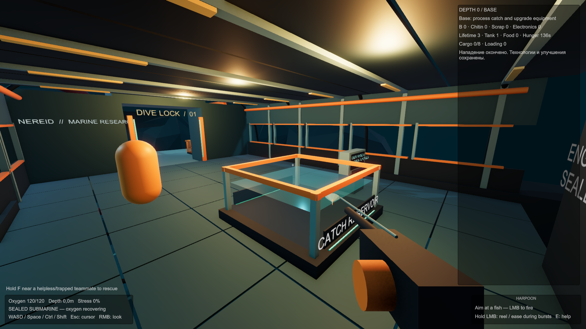
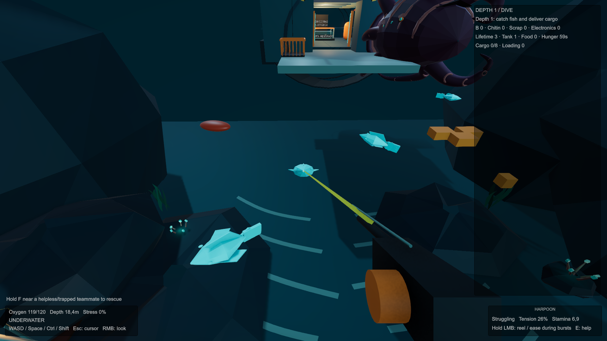
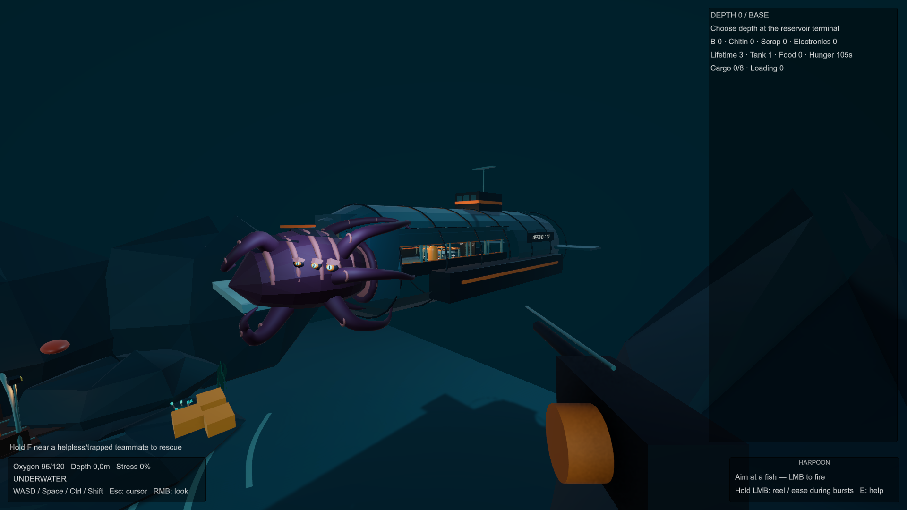

# RAID-010 — Visual Vertical Slice

Ветка `raid/010-visual-slice` создана от `raid/underwater-fishing-incremental`, SHA `651933278e2afd08acb965c78d518fbe68eb1b01`. PR направлен в эту базовую ветку. Слияние не выполнялось.

## Реализовано

- Отдельная сцена `Assets/_Game/Scenes/VisualVerticalSlice.unity`, скопированная с FirstPlayable. Исходная сцена и Build Settings сохранены.
- Большой исследовательский корпус NEREID: рубка, мачта, балластные отсеки, рёбра, маркировка, носовые прожекторы. Внутри — тёплый промышленный отсек с панелями, трубами, иллюминаторами, шлюзом, резервуаром и терминалом.
- Холодная первая локация: гранёные скалы, водоросли, кораллы, затонувший каркас, туман. Визуальная геометрия сохраняет прежние маршруты и не добавляет коллайдеры.
- Крупный паразит закреплён присасывающимся основанием на левом носовом плече. Дыхание и щупальца анимируются локально. Центральный шлюз открыт.
- Два силуэта рыб: компактная Lanternfish и крупная Bristlefish с выраженным гребнем. Новые плавники и хвосты следуют исходной FSM, не меняя transform симуляции.
- Грузовая корзина следует существующему контейнеру; трос лебёдки — его реальному положению. Гарпун от первого лица и начало видимого троса добавлены отдельным presentation-компонентом.
- Резервуар показывает до пяти плавающих визуальных рыб по реальному количеству необработанной рыбы в сетевом snapshot. Отдельный игровой инвентарь не создаётся.
- URP Lit, отдельный Volume с ACES/Bloom и собственный шейдер объёмных надписей с проверкой глубины. Общий URP asset и HUD не менялись.

Основные файлы: новая сцена; `Assets/_Game/VisualSlice/Editor/{VisualSliceAuthoring,VisualKit,ShipVisual,DepthOneVisual,ParasiteVisual}.cs`; `Runtime/{SlicePresentation,FishVisualMotion,KelpSway,ParasiteMotion}.cs`; `WorldText.shader`; материалы, meshes и Volume в `Generated/`.

## Кадры из Play Mode

Сняты встроенным `ScreenCapture.CaptureScreenshot` на конце кадра из настоящей `Diver Camera`, созданной владельцем сетевого водолаза. Обычный FOV 80°, присутствует исходный HUD. Для композиции применялись контролируемые тестовые позиции игрока; это не Scene View и не концепт-арт.

## Выполненные проверки

| Проверка | Результат и границы |
|---|---|
| Исходные файлы PR #7 | 382/382 SHA256 совпадают с `RAID-010/protected-baseline.json`, включая старые Windows-билд и ZIP. Базовая ветка остаётся на `6519332`. |
| Компиляция | Ошибок C# нет. Сохраняется прежнее предупреждение CS0618 в `PlayableAuthoring.cs`; защищённый код не правился. |
| EditMode | До и после изменений: **23/23 Passed**, 0 failed/skipped. Итоговый job `3eb9970c0cac4050857b01de95241453`, 0.787 s. Это тесты экономики, кормления, лебёдки и сохранений, а не автоматическая оценка графики. |
| Сцена | 0 missing scripts/meshes/materials, шейдер без ошибок; 15 исходных NetworkObject с сохранёнными уникальными SceneId. Все 43 исходных physics-компонента идентичны, новых нет; из них 42 Collider. |
| Повторный запуск authoring | 606 renderer до/после второго запуска, 42 Collider. Обновляется только новая сцена и собственные визуальные ассеты. |
| Маршрут | Ввод через штатный RPC моторики провёл игрока через прежний шлюз наружу: `(0,1.2,1)` → `(0,1.2,21.16)`, затем обратно через шлюз. |
| Ловля и доставка | Реальные `FireServer`/`SetControlsServer`, FSM-захват за 13.37 s; загрузка по `CargoId`, штатные фазы лебёдки без ускорения; в резервуаре 1 рыба, cargo 0; команда возврата завершилась `AtBase=True`. |
| Два участника | Редактор — локальный host, отдельный Windows-процесс — client, Tugboat UDP 7770. На сервере 2 соединения, 2 водолаза, владельцы 0 и 1. На кадре отсека виден второй водолаз. |
| Windows | Отдельный development-билд только новой сцены, `Builds/RAID010-VisualSlice/UnderwaterFishing-VisualSlice.exe`. Подробности последней сборки — в приложенном `RAID-010/build-check.json`. |

Тестовая сессия использовала отдельное сохранение в `Logs/raid010/`, а не профиль ручного плейтеста. Между сегментами проверки игрок перемещался в контролируемые позиции; при проверке захвата/съёмке хищник временно приостанавливался, затем возвращался. Это проверка связности штатных систем, не непрерывный ручной плейтест без вмешательств. Полный цикл двумя людьми и Steam между разными ПК здесь не проверялись.

Машинные результаты: `RAID-010/isolation-check.json`, `RAID-010/editmode-check.json`, `RAID-010/build-check.json`; отобранные строки проверки маршрута/RPC — `RAID-010/runtime-checks.txt`.

При синхронном захвате через MCP camera tool редактор зарегистрировал пять сообщений о рекурсивном PlayerLoop. Итоговые кадры сняты нативно на конце кадра. После очистки консоли и повторной работы с двумя участниками новых ошибок/предупреждений не зарегистрировано. В Windows-клиенте исключений игрового кода не обнаружено.

## Производительность

ПК: Ryzen 7 7700X, NVIDIA RTX 4070, 31 894 MB RAM; Unity 6000.5.6f1 / URP 17.5. Game View 1920×1080. В визуальных замерах VSync 0, `targetFrameRate=500`; эти параметры исходного замера не записаны.

Замер: разность `Time.frameCount` за 10 секунд по `EditorApplication.timeSinceStartup`; статичная камера от первого лица с активным Game View. Это среднее FPS, без percentile frame-time и без отдельного GPU-профилирования.

| Сценарий | Среднее FPS | Артефакт |
|---|---:|---|
| FirstPlayable до изменений, статичная камера на высоте глаз, без сети | 553.72 | `RAID-010/baseline-fps.txt` |
| Промежуточный визуальный отсек до финальных прожекторов, host в редакторе, один участник | 256.99 | `RAID-010/interior-fps.txt` |
| Итоговый отсек, host в редакторе и отдельный Windows-клиент на том же ПК | 146.65 | `RAID-010/coop-interior-fps.txt` |

Нагрузка сценариев различается: исходный замер без сети нельзя считать прямым сравнением стоимости графики. Два процесса конкурируют за ресурсы одного ПК. Это измерения конкретного стенда, не обещание FPS на целевом оборудовании.

## Запуск для отдельного просмотра

Для PR #7 используйте **прежний** `Builds/FirstPlayable/`. Новая сцена его не заменяет.

Новый билд запускайте через `Builds/RAID010-VisualSlice/Play-Solo.cmd`: он создаёт отдельный профиль внутри `UserData` рядом с новым EXE и автоматически открывает локальный host. Для второго процесса используйте `Play-Client.cmd` на том же ПК; для другого ПК — меню локального клиента с IP хоста. При проверке Steam нужны два аккаунта/ПК; `steam_appid.txt=480` предназначен только для теста.

В Unity откройте `VisualVerticalSlice.unity` → Play → «Локальный хост». Управление и цикл прежние, см. `HOW_TO_PLAY.md`. В редакторе перед тестом с сохранением нужно отдельно обеспечить изолированный `-raid-save` либо тестовый профиль: обычное меню использует стандартный профиль приложения.

## Лицензии и ограничения

- Новая геометрия, материалы и шейдер созданы в проекте; внешние наборы не скачивались. Список зависимостей и лицензий: `THIRD_PARTY.md`. Новых пакетов нет.
- Паразит — презентационный объект без отдельного ИИ, атак, разрушаемого корпуса и сетевой синхронизации щупалец.
- Внешний корпус шире прежней игровой зоны. Остальные палубы декоративны; у скал, водорослей, корпуса и монстра новых коллайдеров нет. За пределами штатного маршрута возможны проходы сквозь визуальную геометрию.
- Водная поверхность резервуара — простой прозрачный URP-материал без рефракции. До пяти визуальных рыб отражают количество, а не точный состав видов/размер улова.
- Сетевой водолаз, мелкая добыча и атакующие противники сохраняют прототипные модели PR #7. Звуковая полировка и дополнительные анимации не входили в эту итерацию.
- Исходный HUD сохранён, включая крупную правую панель. Его перепроектирование, баланс и игровая логика не менялись.
- Человеческая оценка вида от первого лица, удобства и удовольствия от игры остаётся за отдельным ревью и ручным плейтестом.
