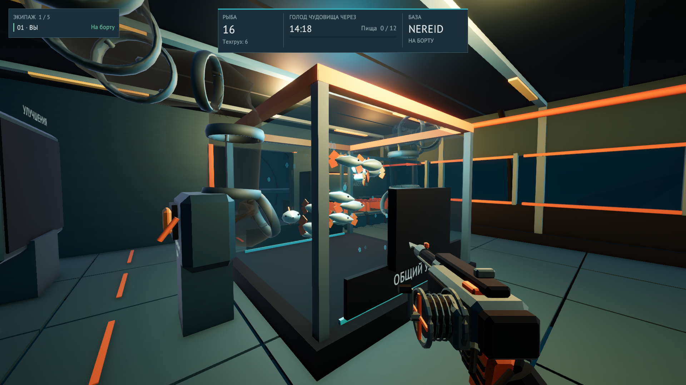
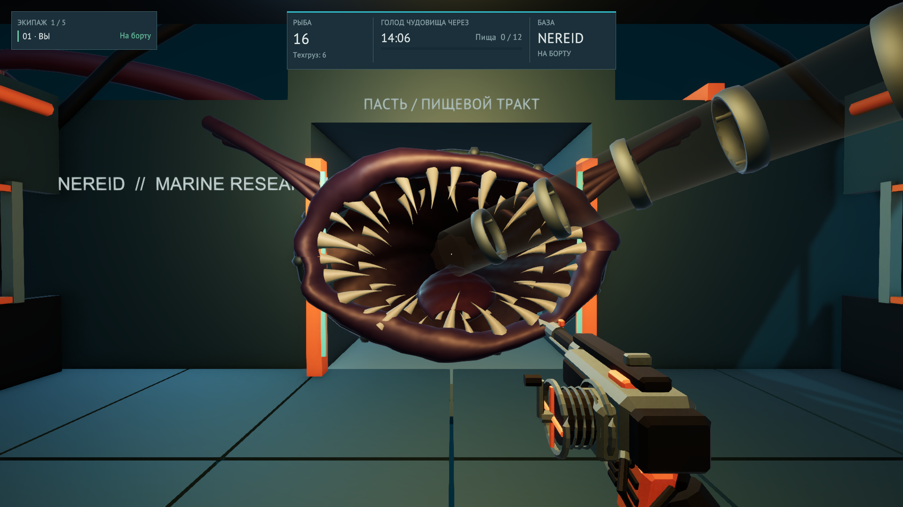
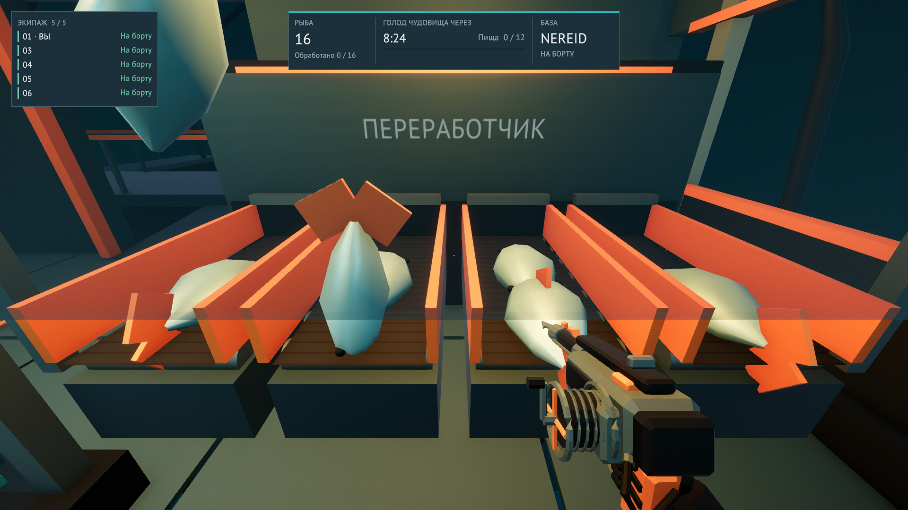
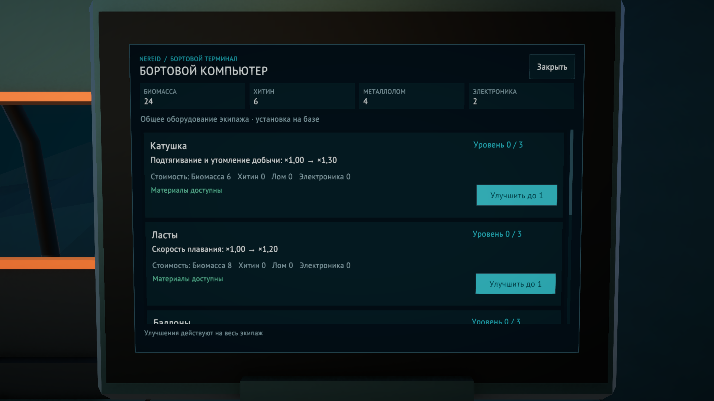

# RAID-011 — UI/UX и физический цикл резервуара

19 ноября 2026. Ветка `raid/011-ui-ux`, основание `raid/010-visual-slice` (`2c6274b`). Изменения предназначены для отдельного PR в эту ветку, без самостоятельного merge.

## Что изменилось

Полностью заменён пользовательский интерфейс новой сцены `InterfaceVerticalSlice`: uGUI, PT Sans/TMP, один управляемый Canvas и EventSystem с Input System. Главный экран, Steam/LAN-подключение, экипаж, пауза, настройки, контекстные действия, спасение, контейнер, резервуар, все пять улучшений и две глубины используют настоящие сетевые данные.

По дополнительному прямому указанию пользователя ночью 19 ноября первоначальный UI-only scope расширен: высокий резервуар, две физические трубы, конвейерный цех, пасть внутри носового отсека, кормовой выход и притягивание напарника. Это осознанное изменение игрового поведения и коллизий **только новой сцены**, а не соблюдение прежнего запрета на любые изменения механик. Ветки, сцены и существующие сборки PR #7/#8 не перезаписаны.

- Центральный прибор показывает реальную рыбу, техгруз, пищу/потребность, голод и глубину. Полный кислород в безопасном отсеке скрыт; опасности, спасение, рыбалка и лебёдка появляются по контексту.
- Пульты по сторонам резервуара выбирают **всю подходящую рыбу**: переработать либо скормить. Подтверждение показывает количество и выход. Техгруз не становится рыбой и не отправляется в кормовую трубу.
- Сервер резервирует выбранный состав, запрещает повторный запуск и переходы во время подачи. Конкретная рыба даёт результат через 8 секунд плюс 0,18 секунды на следующий предмет. Нет оптимистического начисления в UI. Клиенты воспроизводят подтверждённый маршрут; новый наблюдатель получает его текущую фазу.
- В переработчике рыба выходит из трубы, падает по траектории с ускорением 9,81 м/с² на одну из четырёх движущихся лент и входит в машину. В кормовом направлении поток приходит в пасть. Это визуальное представление серверной партии, без добавления сетевых Rigidbody на каждый предмет.
- Улучшения и навигация размещены на физических бортовых экранах. Камера игрока плавно приближается через FOV; персонаж не телепортируется. Оружие скрывается, курсор освобождается; разные компьютеры показывают соответствующие функции. Отдельный монитор резервуара показывает полный прокручиваемый список и переработку технических предметов.
- Гарпун может зацепить реального напарника. Удерживание ЛКМ подтягивает с коллизиями; R стрелка отпускает, R цели отменяет связь, включая открытое меню. После отказа действует защита 3 секунды. Есть ограничения дистанции, LOS, кислорода, heartbeat, длительности и отключения. Прямого урона нет; фактическая глубина продолжает влиять на давление.
- Собственные геометрия гарпуна, хищников и пасти, мокрый URP PBR-шейдер ткани, прозрачные трубы с направлением потока, материалы металла/лент, пузыри, умеренная постобработка и процедурный звук. Исходные визуальные ассеты RAID-010 не заменены.

## Проверки

| Проверка | Результат и границы |
|---|---|
| EditMode | **26/26 Passed**, финальный job `1635d4bf1caa453a97d5205858a95891`, 0 failed/skipped, 0,814 с. 23 прежних проверки экономики/сохранений и 3 проверки состава подтверждаемой партии. |
| Реальные сетевые процессы | Editor-host + четыре Windows-клиента. Все клиенты видели 5 участников, один корневой Canvas, EventSystem и AudioListener. ID владельцев после переподключений имеют разрывы. Клиенты работали в фоне в batch mode. |
| Партия с клиента | 16 рыб: до прибытия начислений нет; по завершении ровно **36 биомассы + 4 хитина**; технический предмет сохранён. |
| Покупка и конкуренция | Хост купил катушку, второе подтверждение старой цены клиента не списало средства. Клиент купил корпус: уровень 1, доступ к глубине 2, остаток 12 биомассы. |
| Четыре материала / глубина | Переработка техгруза клиентом дала итог B12/C4/S4/E2. Клиент запустил действительный переход на глубину 2 при пяти водолазах внутри. |
| Изменение состава | Замена рыбы другой при прежнем количестве отклоняется UI и сервером по хешу состава; сервер вернул `changed`. |
| Переполнение | При пище `int.MaxValue - 1` подача остановилась без исключения: рыба осталась, пища не изменилась, голод продолжал отсчёт. |
| Трос напарника | Реальный raycast хоста зацепил Windows-клиента; перемещение около 2,9 м. Отмена отправлена самим клиентом: связь снята на обоих концах, реплицирован остаток защиты около 2,35 с. |
| Кормление / голод | Клиент скормил 4 рыбы, получил 12 пищи при потребности 18. Естественное истечение периода вызвало недокорм и нападение; произошла фактическая потеря запаса, катушка/корпус сохранены. В отдельных серверных fixtures проверены None, Enough 18/18 и Overfed 24/18 с ограниченным переносом 3. |
| Рыбалка / лебёдка | Хост поймал Lanternfish за 8,49 с через реальный FireServer и управление натяжением; LoadCargo и четыре фазы лебёдки доставили рыбу один раз: запас 6 → 7. Управление подавалось через существующие RPC, без OS-ввода. Для заключительных кадров фаз отдельно загружена одна fixture-рыба; её обычный цикл Hoist также доставил предмет ровно один раз. |
| Спасение | Реальный серверный прогресс удержания достигал 25%; беспомощный удалённый игрок получил около 30 кислорода. Начальная беспомощность установлена контролируемым fixture. |
| Выход | Непрерывное движение CharacterController через кормовой проём и рампу: `(0,1.2,-6.5)` → `(8.56,1.43,-11.38)`, состояние снаружи. После начальной установки позиции телепортов не было. |
| Новый путь нападения | Налётчик достиг последней кормовой точки за исходную длительность 45 с, причинил реальную потерю 2 из 6 предметов; улучшения 1/1 сохранены. |
| Указатель на физическом экране | `EventSystem.RaycastAll` в проекции камеры игрока вернул `Buy_Reel` первым попаданием. Нажатия через контроллер UI передавались серверу. |
| Отключение | Принудительно отключён один клиент; хост и остальные продолжили работу. Отключённый клиент вернулся в Main с одним UI/EventSystem/AudioListener. Остановка хоста также возвращает клиентов в меню. |
| Ввод внутри Windows player | Dev-driver создал локальную виртуальную Keyboard, отправил Escape через Input System: Pause → реальная кнопка Disconnect + подтверждение → Main → повторное подключение. Проверка не использовала физическую клавиатуру/глобальные события Windows. |
| Шейдеры | Unity `ShaderUtil.ShaderHasError` — false для Flow Glass и Living Tissue. |
| Обычная сборка | Windows x64 non-development, `build-f089416849`: **0 errors / 0 warnings**, 32,33 с, отчёт Unity 101,55 MB. Dev-driver отсутствует в скомпилированной Assembly-CSharp.dll. Два экземпляра этой сборки действительно подключились по LAN в фоне (`batchmode/nographics`); в проверяемых журналах исключений нет. Это проверка подключения, без рендера/нативного ввода. |

Использовались отдельные файлы `Logs/raid011/*-test.json`. Запас для длинных списков, граничных чисел и повторяемых кадров подготовлен серверными fixtures; **16 рыб не объявляются вручную пойманными**. Производственный UI не изменяет TeamProgress напрямую. Проверки через файловый dev-driver вызывают UI callbacks/owned RPC и обходят нативное попадание мышью. Driver не входит в обычный player.

Адаптивность: Settings, HUD и физический навигационный компьютер проверены при **1280×720, 1920×1080, 2560×1440, 3440×1440**, масштаб UI **120%**. Во всех 12 сочетаниях `UiCapture.LayoutReport` дал `textOutsideScreen=0 / nonScrollTextOverflow=0`; прокручиваемое содержимое проверено отдельно. Исходное разрешение Game View восстановлено. Кадры — F30/F31/F32.

Замер на RTX 4070, 1920×1080, фоновой Editor Play Mode: четыре серии по 7 с после прогрева, UI включён/выключен попеременно. Среднее 480,58 / 480,43 кадров/с; различие меньше межсерийного разброса. На GPU параллельно работало пользовательское приложение, поэтому это **не контролируемый Windows-бенчмарк и не гарантия FPS**. Исходные значения: [ui-performance.json](RAID-011/ui-performance.json).

Проверяемые результаты: [тесты](RAID-011/final-editmode-tests.json), [пять участников](RAID-011/final-five-peer-check.json), [цикл/фазы/адаптивность](RAID-011/final-loop-and-layout-checks.json), [обычная сборка](RAID-011/windows-build.json), [её подключение](RAID-011/release-smoke-check.json), [сохранность](RAID-011/final-protected-check.json).

## Запуск

Готовая локальная сборка: `Builds/RAID011-Playable/Start-Solo.cmd` — сразу одиночный хост; `Start-Menu.cmd` — меню и кооператив. Архив `Builds/RAID011-Playable.zip`: **44 306 430 байт**, SHA256 `4defa3f9ddc3530466376a15420b7de8204f6551efbb9f834d63eaa2b5a59258`. CRC всех файлов ZIP проверен. Символы Burst `DoNotShip` и пользовательские сохранения в архив не включены. Бинарные сборки находятся локально и не добавлены в Git; их состав/хеши сохранены в отчёте сборки.

Полная инструкция и маршрут плейтеста: [HOW_TO_PLAY](RAID-011/HOW_TO_PLAY.md). Для сборки через Unity указать только `Assets/_Game/Scenes/InterfaceVerticalSlice.unity`, Windows x64, Development Build выключен; исходные EditorBuildSettings не изменены.

## Сохранность и ограничения

- Итоговая сверка SHA256 870 защищённых файлов исходного проекта/сборок: **869 совпадают побайтно, отсутствующих нет**. Единственное намеренное отличие — условное скрытие оружия в `SlicePresentation` при активном новом UI; прежний вид остаётся в старых сценах. Служебные изменения ProjectSettings восстановлены.
- TeamProgress, TeamSave, данные баланса и пакеты не заменены. Формат сохранений прежний. При остановке хоста не доставленная по трубе рыба остаётся в сохранённом запасе; сама анимация после перезапуска начинается новой командой.
- Новая сцена по умолчанию использует отдельный файл `raid011-team-progress.json`; прежние сцены сохраняют прежний путь. Ярлыки сборки используют собственный `UserData/team-progress.json`. На серверном старте фактическое имя нового профиля проверено через MCP; `-raid-save` продолжает работать.
- Переданные в закрытую линию предметы резервируются от кражи и одиночной переработки. Это часть нового физического цикла. Время подлёта налётчика изменилось из-за кормового маршрута; баланс и удобство требуют ручного плейтеста.
- В резервуаре одновременно отображается максимум 48 моделей. В партии отображаются все N предметов с повторным использованием 48 слотов, без ограничения экономики первыми 48.
- Steam transport/API сохранены, development AppID 480. Фильтр сборок — `ui-011-factory`; обе стороны должны пользоваться одной сборкой. **Два отдельных Steam-аккаунта/приглашение через Overlay не проверены**: второй участник отложен пользователем.
- **Полный нативный Windows-плейтест мыши/клавиатуры и переключения Steam Overlay отложен по прямому указанию пользователя** «Позже — продолжайте без переключения окон». Новые проверки не активировали окна и не посылали глобальный ввод. Скриншоты новых экранов сделаны из камеры игрока в Editor Play Mode; batch-клиенты не дали экранных PNG.
- Известный прежний дефект клиентского collider переносимого техгруза записан отдельно в [KNOWN-ISSUES](RAID-011/KNOWN-ISSUES.md); его наличие установлено по исходникам, столкновение в этой проверке не воспроизводилось.
- Собственные процедурные low-poly модели и звук остаются прототипными; это не покадровое воспроизведение концептов. Оценка удобства мыши, читаемости экранов в движении, анимаций и общего впечатления ожидает человеческого плейтеста.

Лицензии: [THIRD_PARTY](THIRD_PARTY.md). PT Sans — OFL 1.1; TMP — поставка установленного Unity uGUI. Новые модели, процедурные текстуры, UI и звук созданы в проекте.

## Кадры из камеры игрока

Все изображения — реальный Play Mode, без наложенных макетов.

Все основные экраны и пояснения к постановке проверок: [каталог кадров](RAID-011/Screenshots/README.md).
