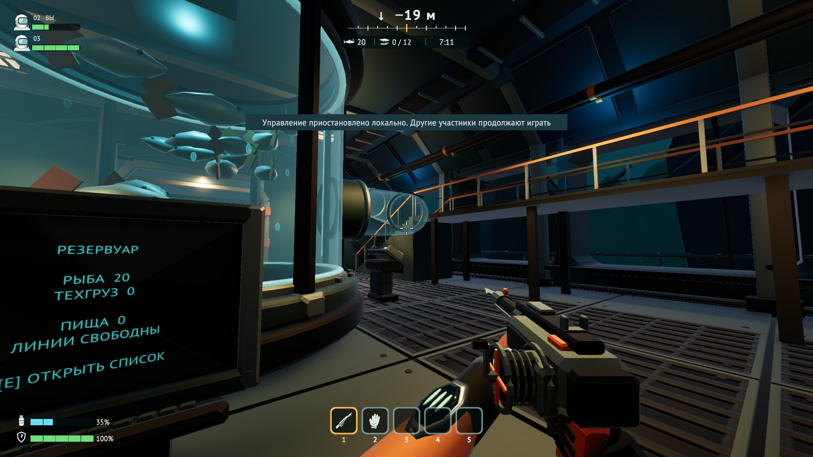
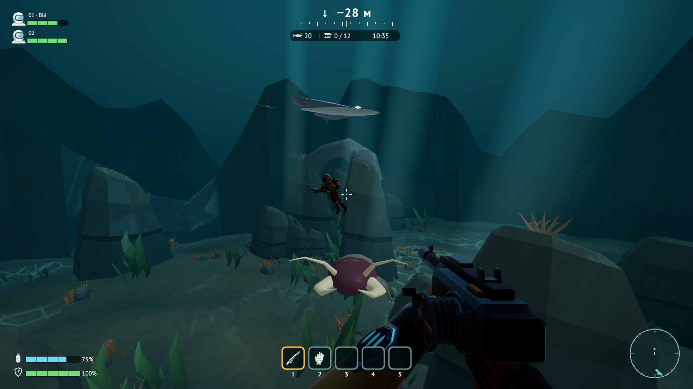
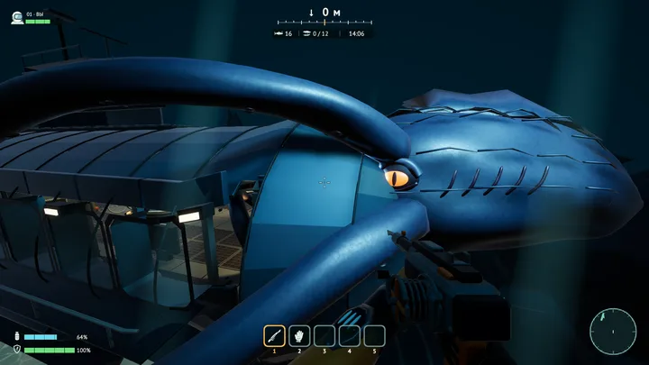
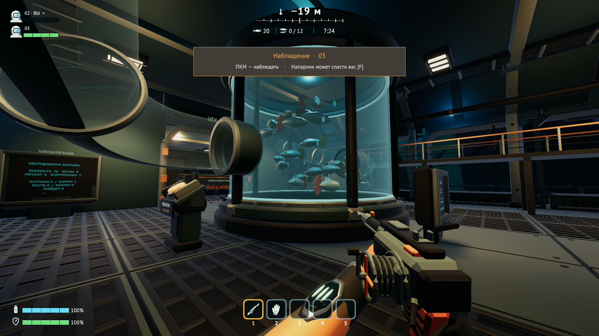
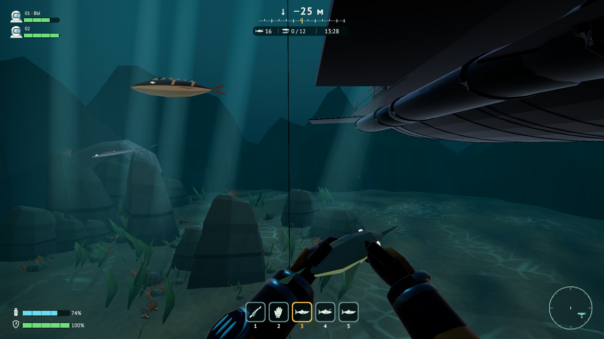
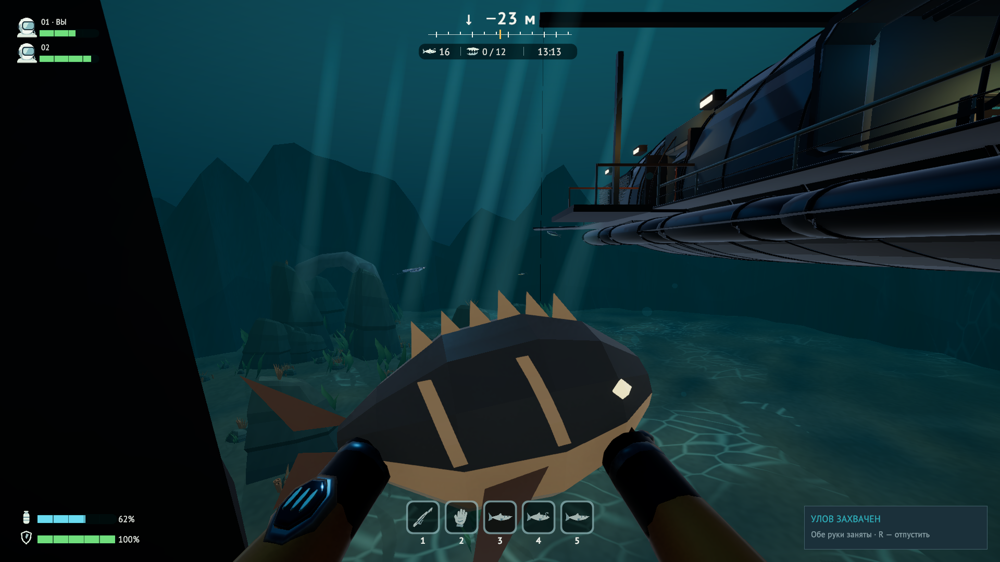
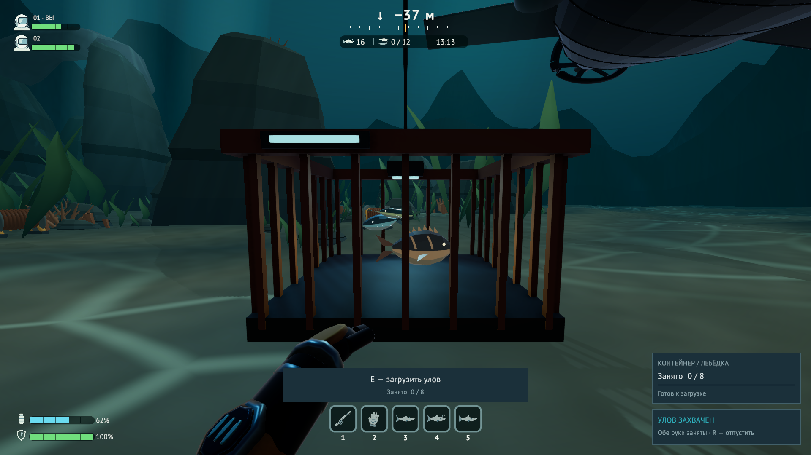
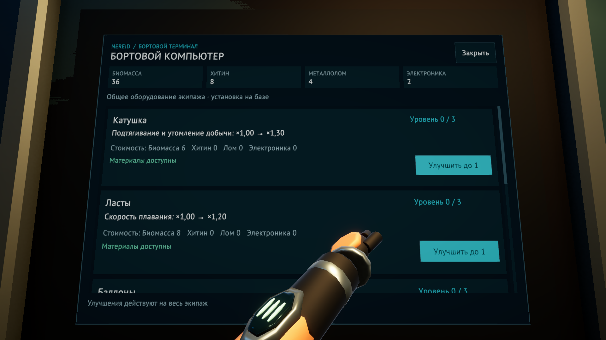

# RAID-012 · Экипаж и живой риф

Windows x64, Unity 6000.5.6f1, URP и FishNet. Игровая сцена — `InterfaceVerticalSlice`. Ветка `raid/012-crew-and-depths` основана на `raid/011-ui-ux` (`aff4cfb`).

## Что можно сыграть

- На экране видны шлемы и состояние реальных членов экипажа, шкала глубины, резервуар, кормление, воздух и запас прочности по давлению. В море навигационный индикатор показывает судно и других водолазов. Горячая панель содержит гарпун, перчатку и три слота настоящего улова.
- Водолазы видят скафандры, ласты, баллоны и снаряжение напарников. Походка и ускорение переходят в гребок и работу ластами за шлюзом. Руки реагируют на выбор предмета, гарпун, работу катушкой, касание пульта и двуручный перенос. На бортовом компьютере открывается панель улучшений с реальными ценами и состоянием покупки.
- Иглорыбу и фонарную рыбу можно поймать одному. Для щетинника и парусного ската нужен напарник. Он подходит к стрелку и держит **E** либо выбирает перчатку (**2**) и удерживает **ЛКМ**. Стрелок выбирает слабину и отпускает катушку при высоком натяжении. Крупная рыба занимает обе руки. Повторный улов того же вида получает новый ID.
- Клеть стоит на дне за правым кормовым шлюзом. Улов плавает за решёткой до разгрузки лебёдки. На борту сохраняется выбор между переработкой и кормлением. Собранный утиль лежит на рифе, его можно поднять и отправить той же клетью.
- Восемь щупалец левиафана меняют изгиб вдоль корпуса. Мантия дышит, а челюсти реагируют на кормление и на водолаза, вошедшего в пасть. Резервуар получил сплошную физическую границу.
- При гибели ввод движения и воздействие троса отключаются. В воде сервер удерживает тело на месте по горизонтали и рассчитывает плавучесть. Камера темнеет. **ПКМ** переключает наблюдение между глазами живых игроков. При истощении кислорода напарник может спасти водолаза, удерживая **F** вблизи. После проглатывания доступно возвращение на борт по **E** через три секунды.
- Риф окружён уступами и аркой, с зарослями и площадками для сбора. Световые столбы и движущиеся блики меняются от участка к участку. Из проектного README перенесены Щелкун, Фонарник, Донный капкан, Сетевик и Кракен. [Описание существ](../../README.md)

## Кадры из камеры игрока

Все изображения получены в Play Mode в сетевой игре. Для кадрирования водолазов ставили на заданные позиции. Величины на HUD, содержимое слотов и клеть берутся из состояния матча.

| Экипаж на борту | Риф |
|---|---|
|  |  |
|  |  |
|  |  |
|  |  |

[Полноразмерный кадр левиафана](03-leviathan.png)

## Проверки

| Сценарий | Результат |
|---|---|
| Компиляция, Windows x64 | Release и Development собраны через Unity MCP. В финальных отчётах сборки 0 ошибок и 0 предупреждений. Release отдельно дошёл до локальной сессии с новым сохранением. |
| Unity Test Framework | 38 из 38 EditMode-тестов прошли. Проверка на 15 сохранённых уловов одного вида покрывает два подъёма и повторную сдачу ID. |
| Резервуар | До исправления луч снаружи проходил сквозь стенку. После исправления луч попал в стенку на x = 3,66 м. Перемещение капсулы к центру с восьми направлений остановилось за стенкой. |
| Пасть, гибель, помощь | Водолаз вошёл между челюстями движением CharacterController. Сервер зарегистрировал проглатывание и отключил контроллер. У погибшего в воде новые команды перемещения и трос сохранили x/z. При спасении независимого клиента команда удержания F прошла через сервер, индикатор дошёл до 1, кислород восстановился. |
| Наблюдение, выстрел | Проверены обе роли по loopback. У камеры наблюдателя расхождение с глазами напарника менее 1 мм, по направлению 0°. Активен один AudioListener. У удалённого стрелка и у наблюдателя зарегистрирован один согласованный выстрел. |
| Перемещение и HUD | При удержании ускорения водолаз прошёл 8,50 м по сухой палубе и проплыл 7,55 м в воде в двух прогонах по 1,25 с. Сервер подтвердил ускорение в обоих случаях. При 1280×720, 1920×1080 и 2560×1080 на игровом HUD не выявлено выхода текста за экран и переполнения строк. |
| Утиль | У шести предметов зазор между нижней гранью и измеренной поверхностью рифа составил 0,00 м с точностью до сантиметра. Сервер подтвердил подбор барабана с металлоломом. |
| Совместная рыбалка | Хост поймал двух иглорыб и фонарную рыбу. Крупной рыбе одиночная тяга не уменьшила выносливость. Независимый Windows-клиент схватил стрелка, оба увидели совместную тягу. При двуручном переносе смена предмета и выстрел были заблокированы. Четыре ID оказались в клети обоих участников, затем перешли в резервуар без потерь и дубликатов. [Протокол](catch-result.json) |
| Угрозы | На двух глубинах пройдены 16 проверок. Фонарник и Щелкун сняли кислород, капкан удержал водолаза, Сетевик отвлёкся на сброс и при атаке украл одну рыбу. Кракен обозначил область удара после работы лебёдки. Стоящий в ней водолаз получил урон, ушедший вовремя избежал его. [Протокол](encounters.txt) |

## Условия испытаний

Сетевой прогон использовал два отдельных процесса на одном компьютере и транспорт FishNet Tugboat. В испытании улова расстановку игроков ускоряли телепортацией. Атаки хищников на это время отключили после первого прогона, в котором стрелок погиб. Попадание, выбор слота, катушка, захват напарника, загрузка и подъём прошли обычную серверную проверку. Угрозы проверены отдельно в активной симуляции, с подготовленными запасами и положением водолаза.

Два физических компьютера и два Steam-аккаунта в этом прогоне не участвовали. Для такого теста сборка использует Spacewar App ID 480. Код протокола лобби обновлён для этой версии. Проверка на 15 уловов моделирует заполнение карманов пяти человек на уровне данных. Пять одновременных игровых клиентов не запускались.

Для одиночной игры распакуйте Windows-архив и запустите `Start-Solo.cmd`. Для лобби запустите `Start-Menu.cmd`. Оба запуска используют каталог `UserData` рядом с игрой. [Результат сборки и SHA-256](windows-build.json)
