# RAID-013 · Шлюз, гипоксия и подводная охота

Ветка `raid/013-pressure-and-hunt` основана на `raid/012-crew-and-depths` (`00444a9`). Игровая сцена — `InterfaceVerticalSlice`, Unity 6000.5.6f1, URP и FishNet.

## Первая рыбалка и срок кормления

В сборке `RAID013-FirstCatch` команда с пустыми резервуаром и клетью и свободной лебёдкой начинает на первой промысловой глубине. Возврат в док остаётся доступен через навигационный компьютер. При восстановлении запасов или незаконченного подъёма лодка начинает у базы.

Отдельный Windows-хост с новым сохранением запустили без команды перехода. На подключённом клиенте при 2:14 до кормления наблюдались три плавающие рыбы первой глубины с включёнными моделями и коллайдерами, тревога отсутствовала. На редакторе-хосте проверили одиночный улов иглы-рыбы. Для повторяемого выстрела водолаза поставили на расстоянии 3,7 м от естественно появившейся рыбы. Выстрел и вываживание прошли через обычные команды владельца, идентификатор рыбы совпал с идентификатором в кармане.

Кормящая труба доставила одну единицу пищи примерно за 1,98 с до срока. Даже при рационе 1/12 дедлайн прошёл спокойно. Следующий цикл с нулём пищи вызвал оборону. В отдельном прогоне клиента с сохранённым запасом на базе прибор показывал 0:08 без предупреждения, затем «Оборона» одновременно с предупреждением о нападении. Следующий трёхминутный отсчёт начинается после завершения обороны. Для проверки граничных условий таймер хоста выставлялся перед нужным моментом.

Прошли 42 EditMode-теста. Windows Release собран из `eaf6528` без ошибок и предупреждений. SHA-256 архива `ee98910d31f085ce4574303035170be5e8b6b930c55c29e7684d3ec53d03b67e`.

## Обновлённый тон экспедиции

В Windows-сборке `RAID013-KeelLight` переработано освещение под лодкой. На снимках из Play Mode маска находится у правого борта, в координатах (21, −8,9, −35). При одинаковом ракурсе медианная яркость участка днища выросла с 13 до 58, скалы справа — с 21 до 79 по шкале 0–255. Все три корабельных прожектора рассеивают свет в воде в профиле PC с текстурой глубины. В сухом отсеке проверен возврат исходного освещения.

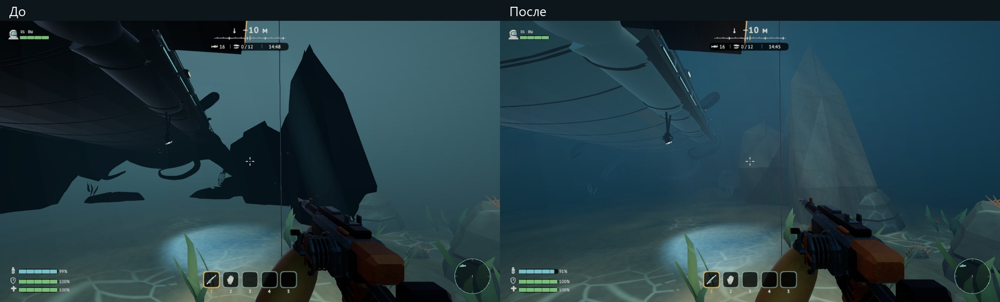

Windows x64 собран из `0167aed` без ошибок и предупреждений. Проверен вход в локальную сессию. Прошли 40 EditMode-тестов и 29 условий сценария рифа в Play Mode. SHA-256 архива `5241cdbcd214ab8177cdf7cc64ac65efac39c24a39f59b917de07126c0ceee6a`.

В сборке `RAID013-Expedition` холодный рассеянный свет даёт направление даже за пределами луча маски. В мутной воде различимы ближние скалы и напарник, вдали рельеф теряется. Кадр сохраняет своё освещение, когда рядом появляется хищник. Перед броском Фонарник разводит плавники и раскрывает светящуюся приманку веером. У шлюза экипаж ориентируется по тёплому контуру двери.

| Пара у каменной арки | Сигнал Фонарника перед атакой |
|---|---|
| 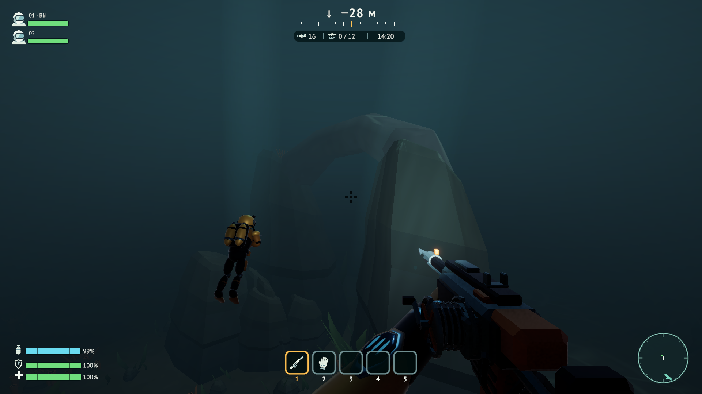 | 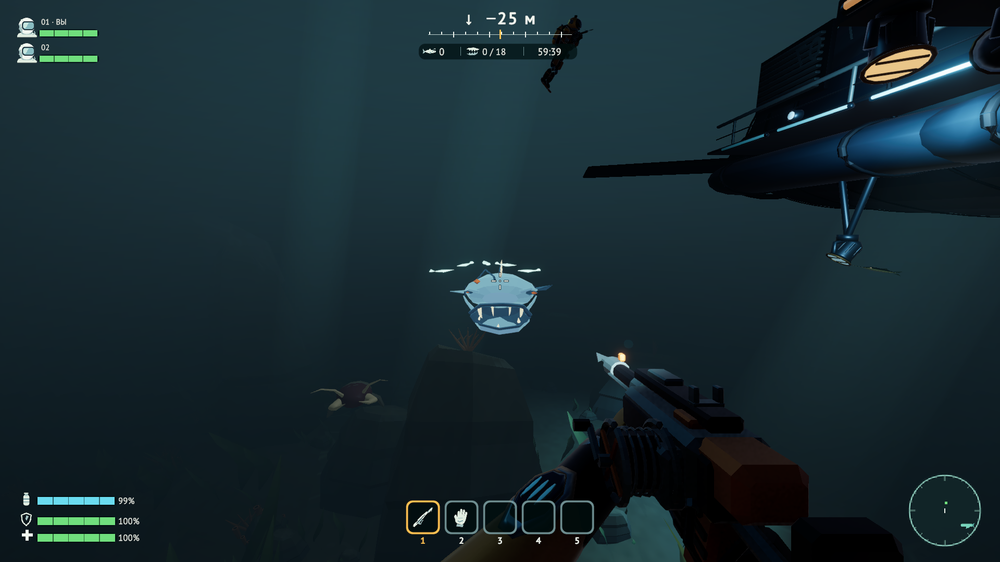 |

[Риф](expedition/reef.png) · [Шлюз из камеры хоста](expedition/hatch.png) · [Шлюз из камеры Windows-клиента](expedition/client-hatch.png)

В этой сборке прошли 40 EditMode-тестов и 28 условий сценария рифа в Play Mode. Release и Development Player собраны без ошибок и предупреждений. Release отдельно запущен до входа в локальную сессию. В проверке освещения участвовали хост и отдельный Windows-клиент. [Версия и контрольная сумма нового архива](expedition/checks.json)

Ниже зафиксированы кадры и измерения первого плейтеста RAID-013.

## Ориентиры в воде

Наружный люк отмечен тёплой рамкой и освещённым краем площадки. Холодный боковой свет выделяет обшивку и рёбра балластных цистерн. Два прожектора освещают дно по сторонам от грузовой площадки. Янтарный прожектор поворачивается за реальной клетью при подъёме и спуске. Удалённые источники отключаются по расстоянию. Корабль видно через световые пятна и контуры, за пределами рабочей зоны вода остаётся тёмной.

| Наружный люк и обшивка | Клеть на дне |
|---|---|
| 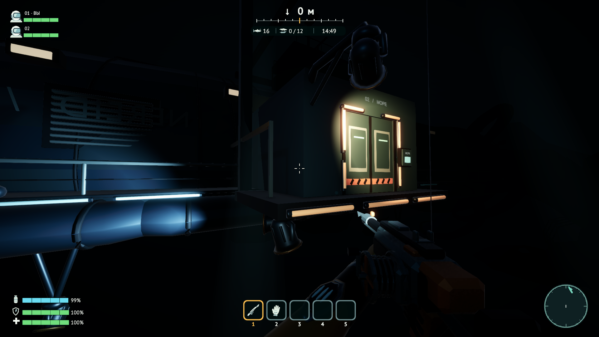 | 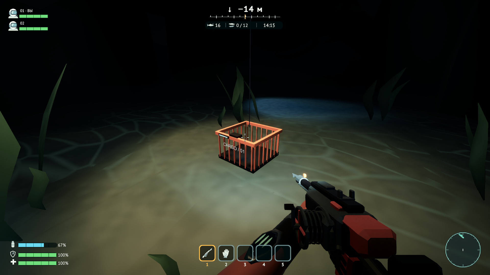 |

В обоих кадрах ниже фонарь водолаза выключен. Слева корабельные прожекторы погашены, справа включены. Положение камеры, момент симуляции и экспозиция одинаковы. Медианная яркость контрольного участка грунта изменилась с 25 до 95 по шкале 0–255, стенки клети — с 5 до 26. Дальняя вода сохранила значение 0,07.

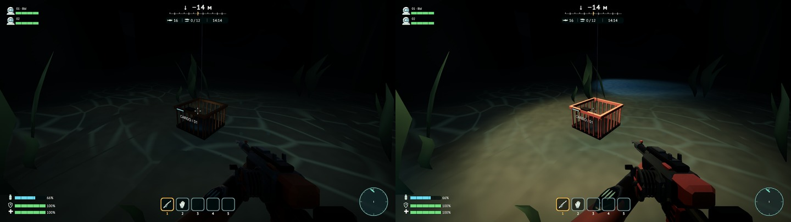

Аудиодвижок отключён. В игровых сценах больше нет источников звука, слушателей и регулятора громкости. Состояния шлюза видны по движению воды и дверей. У хищника читаются разворот, открытая пасть и бросок. Реакция Щелкуна на движение, лебёдку и сопротивление рыбы продолжает рассчитываться в симуляции.

## Что изменилось в игре

- **Шлюз.** Подойдите к панели «Море» или «Борт», наведите прицел и нажмите ЛКМ. Сначала закроется открытая дверь, затем камера заполнится или осушится. Вторая дверь открывается после завершения перекачки. Створка освобождает занятый водолазом проём. Высота воды у тела определяет переход к плаванию, у маски — момент, когда прекращается дыхание воздухом. Из сопла идёт струя, у стока видна воронка.
- **Кислород.** При нулевом запасе можно продолжать движение и взаимодействовать. Периферия обзора темнеет, затем нарастает урон. Воздух останавливает гипоксию, сухой отсек восстанавливает здоровье. Напарник может помочь клавишей F. После смерти сохраняются физика тела, наблюдение по ПКМ и возвращение на борт.
- **Гарпун.** Штырь входит в видимую поверхность рыбы и следует за попавшей под выстрел частью тела или плавником. Трос заканчивается в ушке штыря. Остальные водолазы видят вращение катушки, отдачу и хват обеими руками. Напарник, который помогает удержать крупную рыбу, убирает инструмент. Игрок, подцепленный гарпуном, может снять трос клавишей R.
- **Риф.** Рыба приходит постепенно, одновременно в районе до трёх диких рыб для ловли. Мирная рыба отворачивает от водолаза и уходит от близкого промаха. Фонарник сначала разворачивается и демонстрирует пасть, затем преследует. Маска и освещение помогают различать близкую угрозу в мутной воде.
- **Интерфейс.** Меню, состояние экипажа и панели оформлены в стиле бортовых приборов. Монитором пользуются прицелом, ЛКМ нажимает реальную кнопку, колесо прокручивает список. Взгляд в сторону возвращает HUD. При вываживании один прибор показывает вид рыбы, дистанцию, запас сил, натяжение и нужное действие.

| Заполнение шлюза | Осушение | Гипоксия |
|---|---|---|
| 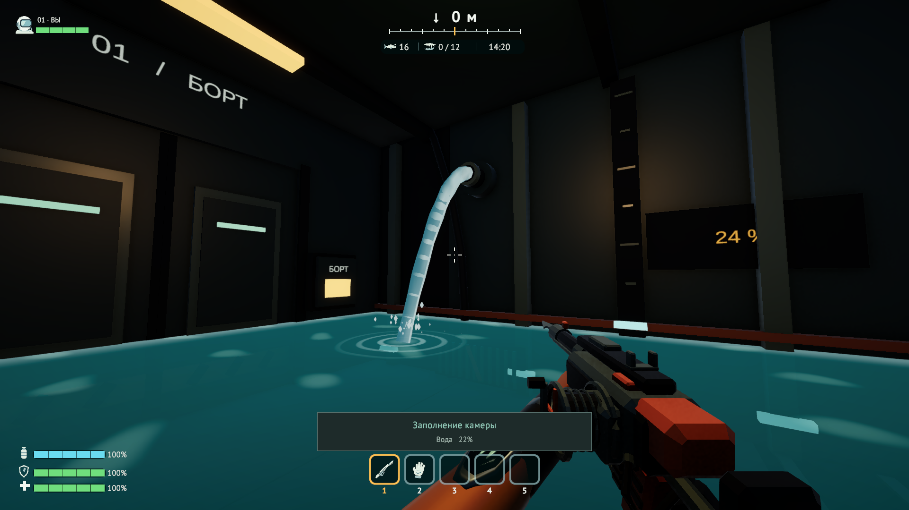 | 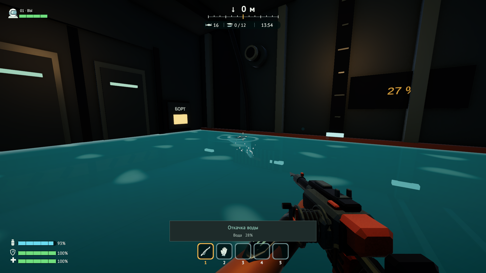 | 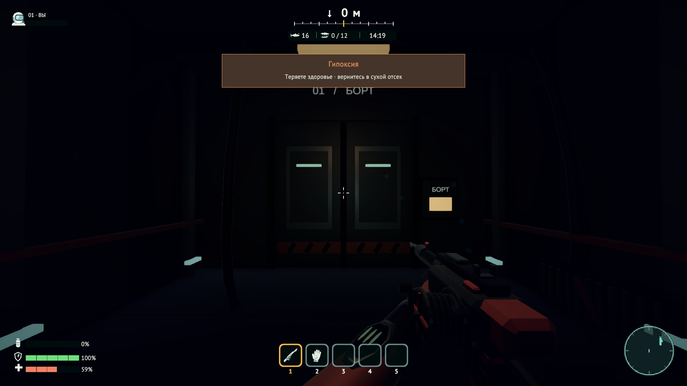 |

| Гарпун напарника | Вываживание | Хищник в атаке |
|---|---|---|
| 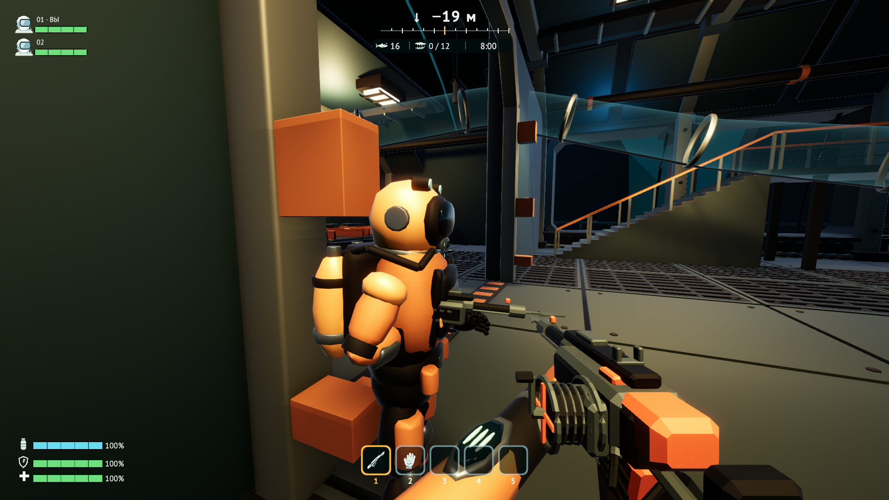 | 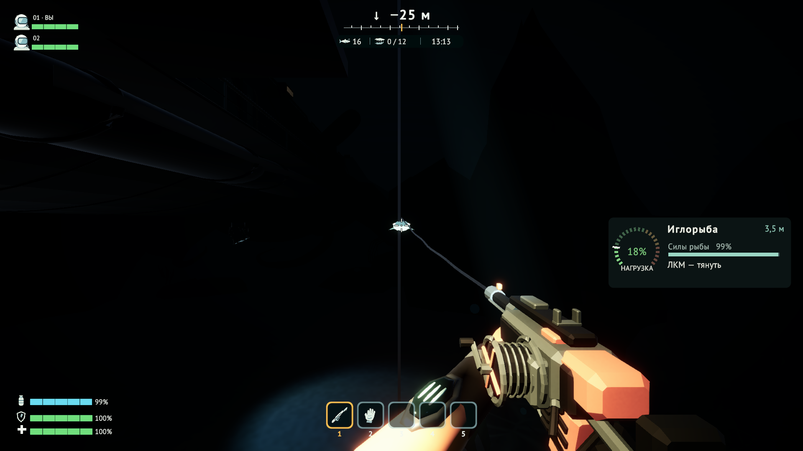 | 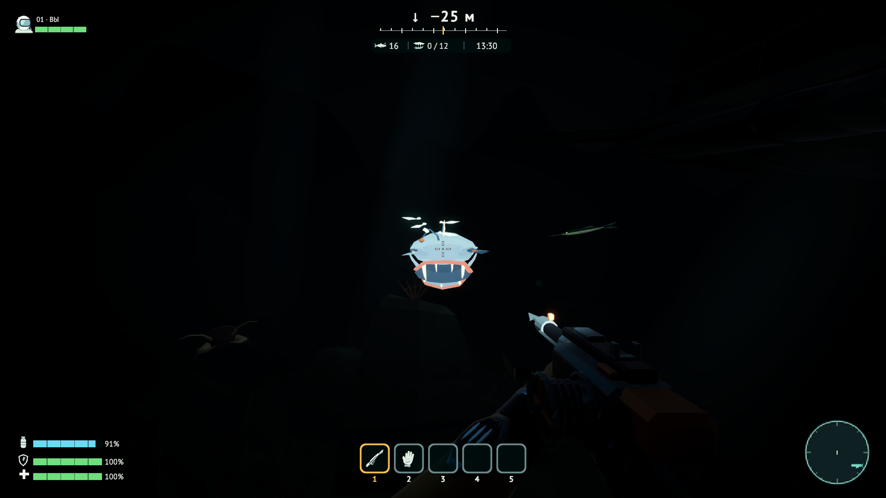 |

[Главное меню](01-menu.png) · [Подключение](09-connection.png) · [Настройки](10-settings.png) · [Экипаж](11-crew.png) · [Пауза](12-pause.png) · [Улучшения](03-computer.png) · [Навигация](14-chart.png) · [Клеть](17-cargo-panel.png) · [Хищник до броска](07-reef.png)

Кадры отдельного Windows-клиента сняты из камеры владельца через URP на RTX 4070 при 1280×720. [Освещённая клеть на клиенте](18-client-cargo.png) · [Кнопка улучшения под прицелом](19-client-computer.png)

## Проверки

| Проверка | Наблюдение |
|---|---|
| Unity Test Framework | 40 из 40 EditMode-тестов прошли. В их числе блокировка одновременного открытия дверей и защита водолаза в проёме. |
| Гипоксия в Play Mode | При O₂ = 0 и 100 HP водолаз сохранил управление. Без помощи к 16,5 с осталось 3,3 HP. В отдельном прогоне клиент запустил осушение. Через 5,42 с маска оказалась на воздухе, водолаз выжил и начал восстанавливаться. |
| Шлюз в сети | Оба состояния дверей и уровень воды совпали у хоста и клиента. Новый клиент, вошедший при открытой наружной двери, получил заполнение 100%, внутреннюю дверь закрытой и наружную открытой. |
| Освещение движущейся клети | Для внешнего участка пути на 25 измерениях подъёма и 19 измерениях спуска максимальные угловые отклонения оптической оси от цели составили 0,03° и 0,02°. |
| Геометрия выстрела | 16 физических попаданий по четырём видам рыб и 256 движущихся поз. Наибольшее расхождение с треугольником модели — 0,002 мм. |
| Кооперативная рыбалка | Отдельный Windows-клиент схватил стрелка. Вместе они вытянули щетинника. За движение точки крепления на 21,9 м штырь отступил от поверхности максимум на 0,004 мм у каждого участника. Три мелких улова и крупная рыба сохранили разные ID до сдачи и подъёма в резервуар. |
| Прицел на мониторе | Клиент навёл прицел на покупку катушки и подтверждение. Уровень изменился с 0 на 1, биомасса с 36 на 30. Лишних выстрелов не было. Отход от экрана восстановил обычное управление. |
| Поведение рифа | Пройдены 28 условий Play Mode, включая действительный промах, уход мирной рыбы, ограничение популяции, предупреждение и преследование, а также встречи с пятью существами. |
| Windows x64 | Сборка для игроков и Development Player собраны через Unity MCP. Самостоятельный запуск Release дошёл до локальной сессии. SHA-256 ZIP и результаты находятся в [checks.json](checks.json). |

Сетевые проверки проводились между редактором-хостом и независимым Windows-процессом через локальное подключение FishNet. Камеры для иллюстраций ставились в заданные позиции в игровой сцене. В длинной проверке четырёх уловов хищники были временно отключены, их поведение проверено в отдельном прогоне. Для проверки Steam-лобби через интернет ещё нужны два отдельных аккаунта.

Для одного игрока распакуйте Windows-архив и откройте `Start-Solo.cmd`. Для кооператива откройте `Start-Menu.cmd`. Управление и порядок подключения описаны в `README-RU.txt` рядом с игрой.
