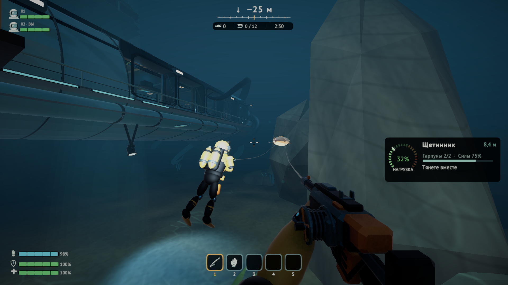

# Сетевая проверка рыбалки

На общей Windows-сборке ветки `f938fa0` второй игрок видел обе лески, рыбу, напарника и Гошу на его баллонах. Точки контакта на поверхности рыбы находились в 0,422 м друг от друга. Обе проверки потери владельца (смерть и переподключение) прошли после доставки четырёх уловов. [Протокол](Integrated/result.json) · [SHA-256 файлов этой сборки](Integrated/player-sha256.json) · [Камера клиента 1920×1080](Integrated/catch-two-harpoons-peer.png) · [Разгрузка на хосте](Integrated/catch-cage.png).

Два Windows x64 Development Player с Unity 6000.5.6f1 запустили `InterfaceVerticalSlice` и соединились через FishNet/Tugboat на одном ПК. Здесь зафиксирован отдельный прогон изменений рыбалки поверх RAID-013. Хост снимал кадры в 1280×720, клиент — в 1920×1080. [Протокол прогона](result.json) · [47 результатов EditMode](editmode.json) · [SHA-256 файлов игрока](player-sha256.json).

| Что проверено | Наблюдение |
|---|---|
| Реальная смотка | Подплывание без смотки сохранило выданную леску. Первую иглорыбу игрок получил у рук с остатком сил 4,42. При трёх занятых карманах выстрел в четвёртую мелкую рыбу сохранил прежний улов. |
| Сопротивление | Удержание одной линии щетинника сдвинуло водолаза на 0,50 м к моменту контрольного замера. Камера расширила FOV, при нулевой интенсивности вернулась к настройке игрока. |
| Согласованная тяга | Оба игрока попали своими гарпунами. При встречной тяге запас сил рыбы сохранился. После перехода на одну сторону щетинника принял первый водолаз. Сервер измерил 0,406 м между точками попадания. |
| Доставка и очистка | Одна крупная и три мелкие рыбы прошли клеть и лебёдку с четырьмя различными идентификаторами. При смене инструмента, смерти и выходе из сессии второго игрока первая линия сохранилась. После повторного подключения карманы второго игрока были пусты. |



В дополнительном прогоне второй выстрел попал в рыбу уже в радиусе рук. До первого действия катушкой она оставалась на леске. [Дополнительный протокол](close-shot.json).

[Три последовательных кадра с камеры при рывке](solo-surge.gif) · [Кадр перед рывком](catch-solo-surge.png) · [Двуручная переноска](catch-heavy.png) · [Разгрузка в клеть](catch-cage.png)

Для воспроизведения возьмите Development Player этой версии и укажите **новую** папку вывода. Сценарий использует изолированные сохранения, ставит рыбаков в заданные позиции, инициирует штатную смерть напарника и держит ИИ хищников на паузе. Выстрелы и смотку выполняют владельцы инструментов через обычные сетевые команды. Отдельный клиент переподключается по LAN. Проверка Steam с двух компьютеров в этот прогон не входит.

```powershell
.\Tools\RAID014\Test-Fishing.ps1 -Player C:\Builds\Raid.exe -Output C:\Validation\Fishing-01 -Port 17844
```
