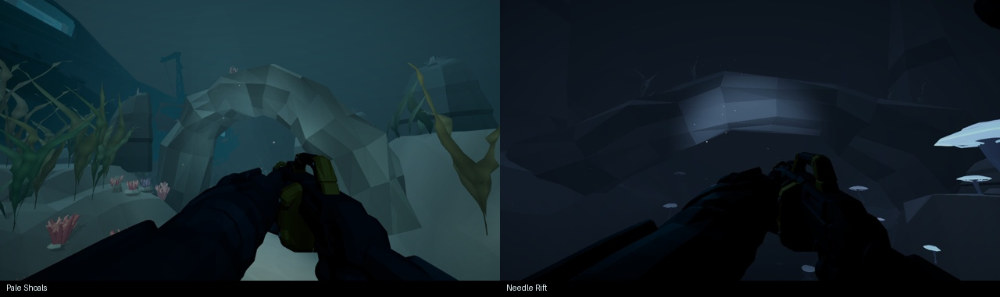
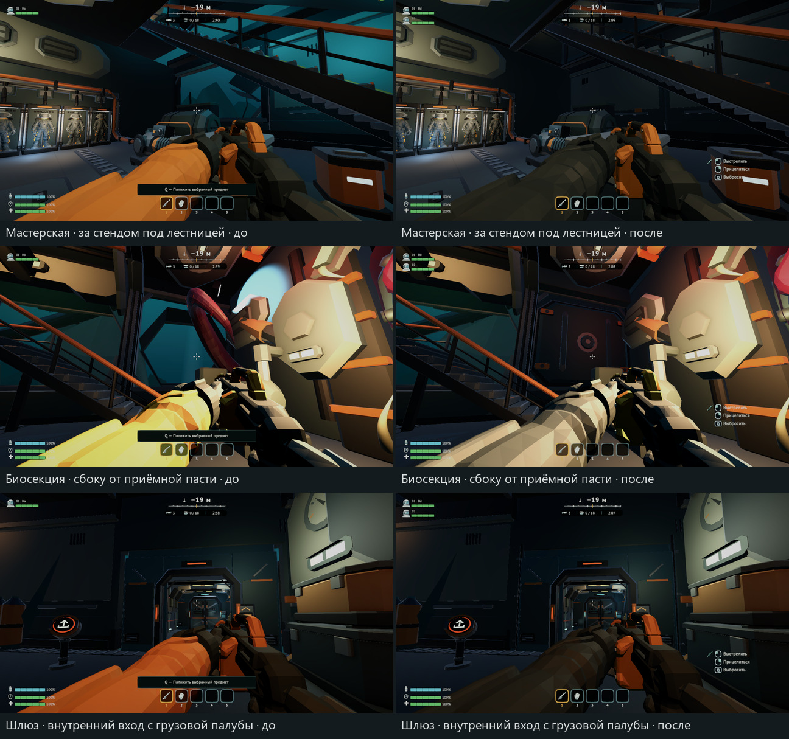
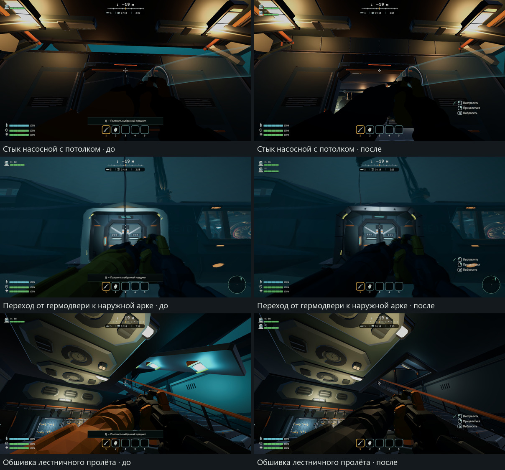
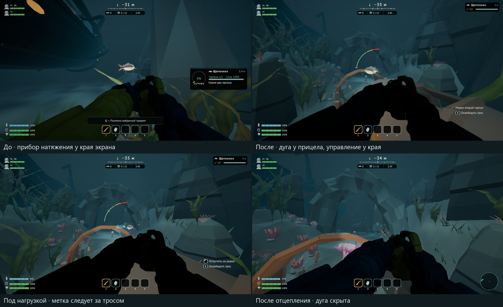
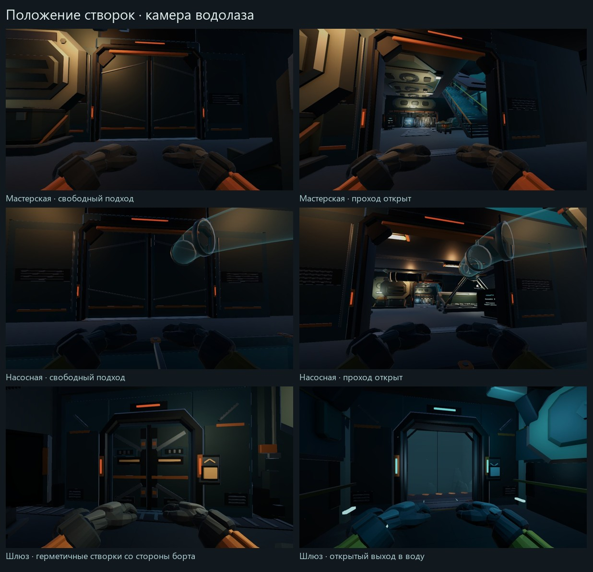
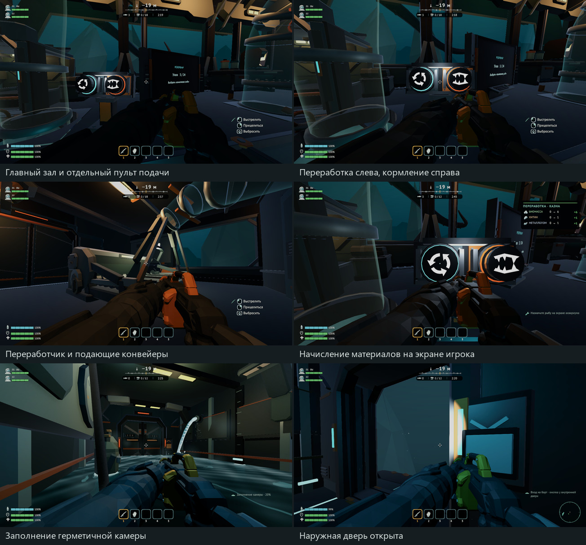
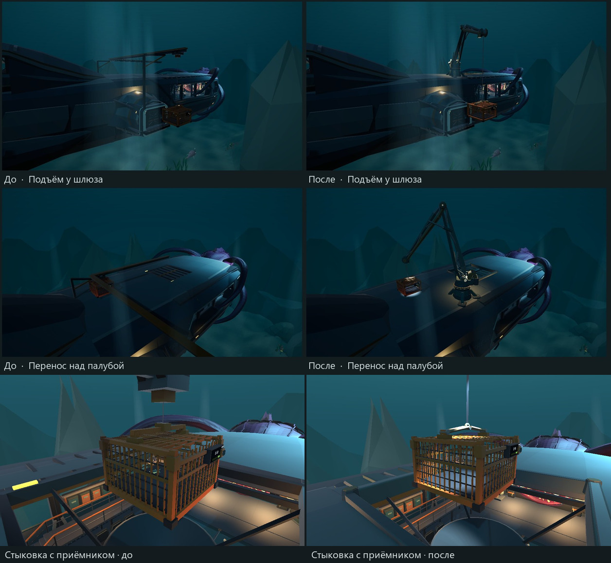

# RAID-020 · Модульная NEREID

Основная сцена — [InterfaceVerticalSlice.unity](../../Assets/_Game/Scenes/InterfaceVerticalSlice.unity). Открывать проект в Unity 6000.5.6f1. Ветка `raid/020-nereid-modular-rebuild` начата от `96304f1126cfc47c877bf252fb782e9e803a8176` в `main`. В основе уже были восемь веток прокачки RAID-019, общий кошелёк, визуальные изменения RAID-016/017 и рыбалка RAID-018 QA-G. Точная история интеграции и разрешённых конфликтов описана в [отчёте основы](FOUNDATION.md). [Резервная сцена](Backups/InterfaceVerticalSlice.unity) имеет Git blob `3f7d544ff76da33bc366eb068829fd1f0276ea04`.

[Windows x64, ZIP](https://github.com/Oblivio-Mentis/underwater-fishing/releases/download/raid020-modular-test/UnderwaterFishing-RAID020-Nereid-Modular-Windows.zip) · [Игровые кадры, видео и протоколы](https://github.com/Oblivio-Mentis/underwater-fishing/releases/download/raid020-modular-test/NEREID-RAID020-Playtest-Media.zip)

[Корпус до и после с трёх одинаковых ракурсов в Unity](NEREID-exterior.jpg) · [Рабочие помещения в игровом плеере](NEREID-in-game.jpg)

Наружный корпус собран из 39 гранёных узлов с 30 статическими коллайдерами. В нём 7 602 треугольника. У предыдущей версии с картами износа было 113 778. Сталь, окантовка мостика и гондолы имеют однотонные материалы. При одинаковых камере и свете на сравнении видны изменения геометрии. Габариты оставляют свободными шлюз, траекторию клети и три трубопровода.

Свежие изменения рыбалки включают провисание и натяжение троса, движения гарпуна на рывках, след от хвоста, отметки зацепа и подъёма рыбы. При направленной вверх тяге верхний край экрана остаётся свободным. На ходу и в воде левый локоть опускается. Положение опорного плеча и направление сгиба доступны в `DiverAvatarRig → Harpoon support while moving` для первого лица и модели напарника.

## Что редактировать в Unity

| Объект | Где открыть | Что можно изменить |
| --- | --- | --- |
| Подлодка | [NEREID_Rebuilt.prefab](../../Assets/_Game/Nereid/ShipRebuild/Prefabs/NEREID_Rebuilt.prefab) | Корпус, остекление, освещение, оборудование и расположение вложенных префабов |
| Внешняя обшивка | [OceanEnvelope](../../Assets/_Game/Nereid/ShipRebuild/OceanEnvelope) | Раскрыть вложенный префаб, выбрать секцию борта, гондолу или фонарь. Редактировать цвет, металл и гладкость в `Materials` |
| Отсеки и посты | [Rooms](../../Assets/_Game/Nereid/ShipRebuild/Prefabs/Rooms) · [Stations](../../Assets/_Game/Nereid/ShipRebuild/Prefabs/Stations) | Обзорный зал над резервуаром, мостик с лестницей, грузовой и технический отсеки, биосекция, шлюз, место Гоши. Физические экраны привязаны к разъёмам постов |
| Трубы | [Plumbing](../../Assets/_Game/Nereid/ShipRebuild/Prefabs/Plumbing) · меню `NEREID / Pipe Route Editor` | Выбрать впуск, кормление или переработку. В Scene View переместить узлы и касательные. В Inspector задать разъёмы, сечения, материалы и радиус. Команда `Rebuild Selected Pipe` перестраивает выбранный участок маршрута |
| Пульт подачи | [Aquarium dispatch post.prefab](<../../Assets/_Game/Nereid/ShipRebuild/Prefabs/Stations/Aquarium dispatch post.prefab>) внутри ObservationHall | Единая напольная стойка у монитора резервуара. У клавиш отдельные коллайдеры, направление, ход и точки контакта ладони |
| Шлюз | [PressureDoors.prefab](../../Assets/_Game/Nereid/ShipRebuild/Prefabs/Rooms/PressureDoors.prefab) внутри AirlockCollar | Четыре створки с коллайдерами, ход дверей, четыре кнопки и границы уровня воды. Состоянием управляет сервер |
| Переработчик | [Nereid separation press.prefab](<../../Assets/_Game/Nereid/ShipRebuild/Prefabs/Processor/Nereid separation press.prefab>) | Приёмник, четыре транспортёра, вальцы и выходные лотки материалов |
| Клеть и люк | [Cargo](../../Assets/_Game/Nereid/ShipRebuild/Prefabs/Cargo) · меню `NEREID / Cargo Rail & Hatch Editor` | Передвинуть точки загрузки и стыковки, проверить свободный проход, просмотреть движение. Поворотная тумба, стрела, рукоять, цилиндры, барабан и шкивы находятся во вложенном префабе `Articulated recovery crane`. У люка и приёмника собственные префабы |
| Дайвер | [Diver.prefab](../../Assets/_Game/Prefabs/Diver.prefab) · [модели, материалы и клипы](../../Assets/_Game/Factory/Diver) | `CrewDiver` для экипажа и `FirstPersonDiver` для собственных рук. В `DiverAvatarRig` настраиваются кости, кисти, хват и список клипов по действиям. Для костей без ключей клипа сохраняется игровая поза |
| Гарпун | [ExpeditionHarpoon.prefab](../../Assets/_Game/Factory/Resources/ExpeditionHarpoon.prefab) · [FBX и атлас](../../Assets/_Game/Factory/HarpoonArt) | У игрока, напарника и брошенного предмета один префаб. В `HarpoonVisualRig` доступны катушка, затвор, гарпун и точки выхода и крепления троса. Для группировки изменённых деталей FBX есть `RAID / Art / Rebake expedition harpoon from selected model` |

Комплект гарпуна собран из 50 исходных деталей. В игровом префабе 4 763 треугольника, пять рендереров и один общий материал. Длина модели 0,68 м. В префабах дайвера доступны четыре нативных клипа для хвата и панели. При смене снаряжения, выстреле, намотке, переноске, замахе мячом и взаимодействии с Гошей используются игровые позы. Оба вида используют собственную привязку к соответствующему скелету.

В модуле прокачки четыре костюма DIVER и шесть гарпунов. Четыре стоят в зарядной стойке, два у сервисного верстака. Силовые линии ведут к шкафам, тележке сменных батарей и насосу. В грузовом отсеке появились рама с фиксированными ящиками и тележка с барабаном. В шлюзе стоят дыхательные баллоны, у камеры кормления — ресивер с клапанным шкафом, у лежанки Гоши — запас подстилки и дозатор. У аквариума разместились стол для исследований и места наблюдателей, на мостике — два кресла вахтенных и стол с рельефной картой. Мебель можно перемещать отдельными вложенными префабами.

Материалы костюма и гарпуна предлагают семь редактируемых цветов в Inspector. Импортёр выбирает цвет для каждой соединённой детали по исходному FBX и атласу. Игровой шейдер использует цвет вершин. Полноразмерный костюм отображается с 9 791 треугольником, у исходного уровня детализации 51 382. В исходной модели сохранены все пять уровней, артикулированный скелет и UV. Для повторной выпечки после изменения исходников есть команда `RAID / Art / Refresh expedition part paint`.

Для рук от первого лица 3 874 исходные вершины сверены с пользовательским FBX в пространстве привязки. Семь поз проверены на локальном хосте Unity. Максимальная разница длины сегмента между видом из шлема и моделью экипажа — 0,003 мм. При удержании гарпуна в обеих позах запястья совпали с точками хвата, а при удержании и замахе концевые кости пальцев вошли в поверхность мяча не более чем на 2,4 мм. Для кадра полного прицеливания тестовая обвязка выставила конечное значение прицеливания.

## История изменений

| Область | Коммиты |
| --- | --- |
| Корпус, комнаты, переходы, размещение постов и заделка окон | `612f04a5135ab01bbfd59916cfc4093d4144ea6a`, `ed4249fce796cf0bea4ef84db8b690c0def757a6`, `f114498d98029ff85fa2ee09aa01d575a5ee4867` |
| Рельс, сегменты труб, монтаж в основной сцене и проходы через палубу | `c1e2dce308540478d4dc097413c121b7167f8c18`, `ad754d3cc8454d87423962c137593dbb289c218c`, `ae0b906c1dcdad76f7014545234c31236d117fda` |
| Дайвер и руки | `5c843b6a5f3b0933076f611844ca29cd9ecc691b`, `e67a35c232fb002ebf97f232d8503a680234ecb6`, `3e0fde99316c54912e6c595b09feb394f2ccf657`, `6b509027671ba53ad4e74ce4f68637d669f5ca02` |
| Новый гарпун и полёт снаряда | `9152eb79123fccbc9ed69b70916ad44b765a08b4`, `a731bc666604ac917ede5f23a0c05206092c2787`, `d961544731e47696cf175f84e779d89bb1f01a81`, `e4eaf969ee8bb4bf42855e6d58bb96e8c94d725a` |
| Заслонки, привязка к действующей сцене | `17ee5aa95a1b291ab49e99668128181d63514ad4`, `687f960ea7d4bf31da26124bcf6b86b0d1834b98` |
| Параллельная доработка воды шлюза, вошедшая в ветку во время проверки | `f326b8a1d6e921c0aa597fbad5d4cdd008031226` |
| Корпус, оснащение помещений и оборудование мастерской | `f14ce83`, `dc41e2c`, `330bced`, `1e3dab7` |
| Промежуточный вариант стального корпуса и приборов | `6d84ea8`, `0a0c772`, `c1d798b` |
| Матовая палуба, промышленное покрытие, материал брызг и запуск приборов при подключении | `df9dd79`, `9bd35bb`, `708c743`, `5c3d9d8` |
| Исходная длина рук, хват экспедиционного гарпуна и мяча | `bba5b06`, `d40f8ac`, `35a03d9` |
| Гранёная наружная обшивка, однотонная палуба, шельф и разлом | `773e18f`, `af83e8d`, `d5472e7` |
| Палитра отсеков, крупное оборудование, научный зал и мостик | `8fbe1d4`, `c35e67b`, `d744217` |
| Снаряжение для четырёх, верстак, покраска по деталям, LOD модели | `9e1ef6b`, `8b9392c`, `d93023c`, `b6c4b6f`, `85b6382` |
| Сетевой сценарий вываживания крупной рыбы и проверка кистей в плеере | `d22b235`, `0595c51` |
| Обрамления шлюза, кассеты и две автоматические межотсечные двери | `e920e8e`, `3252d61`, `f2f48e7` |
| Физический шлюз, откачка, удержание дверей и повторный вход клиента | `2303278`, `f56bb7f`, `2ea1a80`, `53bf7fd` |
| Прицельные посты, нажатие и сетевое подтверждение | `fc12e88`, `cb7a929`, `accacbc`, `5c16247` |
| Парный пульт подачи в главном зале и проверка подхода | `9fe07656a4aa354dec60cdae31f2889f318b6137`, `a35f1ef6998f25a6c10105a76a9b5bfeae6a0a68` |
| Три рабочих дисплея и кнопка грузового поста | `b1b4cc1`, `b8759e0`, `8db6b76` |
| Палубный кран, монтаж в основной сцене и контроль габарита груза | `89cb24c`, `39f92ae`, `e72f2fb` |
| Сопряжения насосной и наружного шлюза, предпросмотр в Scene View | `8667c19` |
| Кассеты внутреннего шлюза, сопряжение с грузовым отсеком | `6cebda9`, `93dac03`, `565cb0c` |
| Глухая переборка мастерской и внешний левый борт | `4993867` |
| Изоляция биосекции, движение двух передних усов и наружные прожекторы | `8592e11`, `bfb70e8` |
| Нативные префабы шельфа и разлома в основной сцене | `7a5ea88`, `6054834` |
| Рыбалка Claude (`73189df`, ветка `raid/020-fishing-feel` на `ebc195f` и локальная версия эффектов и прицеливания) | `9dbcb5c` |
| Опорный локоть при движении с гарпуном, настройки в префабах дайвера | `a68a662` |
| Случайное заселение мест обитания на сервере и данные для проверки подключения | `561a7d6`, `48a26b7` |
| Прицел, дуга натяжения, прозрачные подсказки и предупреждения | `efca22f`, `2493147`, `22004cb`, `074a35c`, `6b28ed8` |
| Загрузка рыбы по ПКМ и песок при посадке клети | `c37032f`, `f373287`, `2f6bdfb`, `4d86c19` |
| Разворот крана, сопровождение груза прожектором, сигнальный огонь | `14baf49`, `7875bda`, `5ca5fa2` |
| Бег по палубе, закрытые плечи и бросок мяча из ладони | `1ce1717` |
| Обшивка и проход лестницы, проверки разрывов оболочки в основной сцене | `4bbb4e0`, `c9c8dbe` |
| Маршрут Гоши через автоматически открывающиеся створки | `ee52f35` |
| Положение разгрузки, открытие грузового люка с упреждением и проверка треугольников | `1b25bd7`, `c8f9be7` |
| Сепаратор, транспортёры и выходные лотки | `eb0c0fa`, `95fa3f3` |
| Ракурсы игрового захвата | `6666eb59fc8b45a3da3d16aad5264d007f8081c0`, `e79f08e` |
| Сценарий натяжения троса и поворота камеры во время рывка | `e6a5844`, `6f1a08b` |

В генераторе пультов обе ветки добавляли оборудование сразу перед возвратом нового префаба. В `cb7a929` сохранены крепления экранов и установка клавиш. По последующей правке пользователя клавиши переехали на отдельную стойку в главном зале. Из основной сцены убраны экраны у переработчика и кормушки. Для подъёмника предусмотрена отдельная кнопка.

При слиянии `EquipmentRoom.prefab` обе правки добавляли разных детей корневого трансформа. В `1e3dab7` сохранены шкафы с присланным оборудованием и отдельный префаб систем отсека. Конфликт разрешён объединением экземпляров. Проверка в основной сцене включает физический экран прокачки.

Обе карты размещены в `InterfaceVerticalSlice → NEREID fishing grounds`. Глубина 1 — [Pale Shoals.prefab](<../../Assets/_Game/Maps/Pale Shoals/Pale Shoals.prefab>), глубина 2 — [Needle Rift.prefab](<../../Assets/_Game/Maps/Needle Rift/Needle Rift.prefab>). Двойной щелчок по префабу открывает район со скалами, дном, растительностью и коллайдерами в Prefab Mode. В игровой сцене включается экземпляр выбранной глубины. Материалы обоих районов находятся в [Maps/Materials](../../Assets/_Game/Maps/Materials). После изменения по одной скале в каждом префабе редактор сохранил геометрию. Переход с шельфа в разлом и обратно через навигационный пост использовал те же два экземпляра. На шельфе 37 объектов с мешами и 9 коллайдеров, в разломе 25 и 4. Крупные формации объединены в меши по участкам.

Семь районов первой глубины и шесть районов второй задаются в [ReefHabitat.asset](../../Assets/_Game/Data/Fishing/Profiles/ReefHabitat.asset). В Inspector можно изменить точки маршрута, радиус и верхнюю границу. При рождении и возвращении рыбы сервер случайно выбирает место вдоль маршрута с учётом предпочтений вида, грунта, препятствий и присутствия водолазов. У противников собственные территории. Области появления налётчика и донных существ настраиваются в [NereidThreats.asset](../../Assets/_Game/Nereid/Generated/NereidThreats.asset). На 12 рейсах собрано 204 позиции: 144 для промысловых рыб и 60 для хищников, налётчиков и донных существ. Таблица координат и замеры позднего входа входят в каталог `Marine-Habitats` архива. На каждой глубине к хосту присоединились два отдельных клиента. На всех трёх совпали ID рыбы и координаты донных существ. В 576 отсчётах при асинхронном опросе максимальное расхождение положения плывущей рыбы достигло 0,68 м.

В режиме редактирования у створок сохранена закрытая монтажная поза. Команда `RAID → NEREID → Preview dry lock and open passages` показывает сухой шлюз и открытые межотсечные двери. Повторное нажатие возвращает исходную позу.

## Палуба и рыбалка

По палубе дайвер движется с противофазным шагом, в воде используется гребок. У рукавов сохранён исходный масштаб. Два игровых процесса зафиксировали нейтральную кисть после остановки, плавание и броски из сокета мяча в ладони. При коротком и полном замахе скорость составила 5,37 и 15,61 м/с.

Верхняя левая дуга показывает нагрузку на собственный трос, справа видны вид рыбы, дистанция и число зацепов. На последних секторах, кроме цвета, есть насечки. Маркер исчезает после схода рыбы. Рыбу выпускают по ПКМ, глядя в открытый контейнер. Q кладёт выбранную рыбу перед дайвером, где её может подобрать напарник.

Кран начинает разворот, пока закрывается клеть. Рабочий прожектор направляется на верхнюю проушину груза, янтарный маяк пульсирует при движении и горит ровно при разгрузке. При возврате основание паркуется, свет гаснет. У дна из-под клети расходится песок. В префабе крана редактируются угол парковки, вылет стрелы, оптика и интенсивность света.

## Подача рыбы и выход в море

На борту три рабочих монитора — у аквариума, на мостике и в отсеке прокачки. Рядом с монитором резервуара расположен общий напольный пульт. Между центрами клавиш 0,79 м. У левой бирюзовой клавиши знак круговых стрелок, у правой янтарной — пасть. Экран сохраняет назначение каждой рыбы. Нажатие на клавишу запускает соответствующую линию. Нажатие на общую отправку на экране запускает обе очереди. В сетевую команду входит точка, на которую был наведён прицел в момент нажатия. Сервер проверяет досягаемость и видимость конкретной клавиши, благодаря чему быстрый поворот к пульту тоже работает.

Переработчик принимает рыбу на одну из четырёх лент. Валы затягивают её внутрь и срабатывают лотки полученных материалов. Итог виден на экране игрока. Для выхода в море нужно войти в шлюз и нажать голубую клавишу у наружной двери. После закрытия внутренней двери камера заполнится водой и наружная створка откроется. Для возвращения нужно нажать янтарную клавишу у внутренней двери.

В инженерном и насосном отсеках пустой проход закрыт до центрального уплотнения. Обе двери открываются автоматически при подходе с любой стороны. Створки уходят в боковые карманы. Сервер удерживает проём открытым, пока в зоне находится член экипажа, Гоша или нападающее существо. Состояние дверей передаётся подключающимся игрокам. В каюте Гоши арка шириной 2,73 м расположена перед спальным ложем. Через порог прошли рядом две капсулы шириной 0,66 м с расстоянием 1,28 м между осями.

## Игровая проверка

- Release-плеер x64 запускает основную сцену. Независимый процесс подключился по LAN на той же машине. Создание новой кампании сохранило исходный файл сохранения. Steam через интернет с двумя аккаунтами в эту проверку не входил.
- В Unity EditMode прошёл 61 тест из 61. В проверке сцены луч прицела достигает работающих пультов с сухого места оператора. С одной позиции у аквариума доступны обе клавиши подачи. Изменения положения монитора, изгиба трубы и места загрузки сохранились после повторного открытия сцены.
- При проверке проходов все 51 точки опирались на палубу или ступень. Пять проходов свободны для капсулы игрока, минимальная измеренная высота над лестницей — 4,31 м.
- Проверка груза проследила четыре вида рыбы с уникальными `CargoId` от загрузки по ПКМ до аквариума. После возврата клеть открылась, для каждого ID осталась одна рыба. На терминале отдельный выбор назначения и последующая отправка проверены также для смешанной партии. Рыба без назначения остаётся в аквариуме.
- В первом прогоне после установки межотсечных дверей Гоша потерял маршрут к брошенному мячу: при построении графа закрытая дверь разрывала связь между отсеками. Теперь граф учитывает открытие двери при приближении питомца. В каждом физическом шаге продолжают проверяться створки, рамы и стены.
- После установки двусторонних вставок все 42 луча над насосной и 42 луча на верхние и боковые стыки наружного шлюза попали в геометрию с обеих сторон. На контрольном подходе створки насосной начали движение за 5,12 м, мастерской — за 5,03 м. Создание префабов, измерения и виды с обеих сторон сохранены в истории ветки и в архиве материалов.
- Лестница в мастерской проходит внутри обшитого колодца. Светильники подвешены к поперечным рамам, а верхний проём выровнен с лестницей и расширен до 4,29 м. Контроллер игрока прошёл вверх и вниз по центру и обоим краям. До правки десять боковых лучей выходили за обшивку, после правки все упёрлись в неё.
- У внутренней двери шлюза между краем кассеты и бортом оставался зазор около 35 см с каждой стороны. После установки боковых панелей все 60 лучей встретили новую обшивку при закрытых и все 60 — при открытых створках. По трём полосам проход был свободен в открытом состоянии и перекрыт в закрытом. За стендом мастерской внутренняя переборка состыкована с наружной обшивкой. Световые проёмы обзорного зала и мостика сохранены.
- В биосекции оба сервисных проёма закрыты съёмными панелями, а два передних уса и прожекторы вынесены за обшивку. В редакторе и в игре все 272 луча пересекли видимую и физическую геометрию. У трубы кормления проверены 162 положения, у анимированных усов минимальный измеренный зазор до панелей составил 1,38 м. При проглатывании рыбы 20302 верхняя губа прошла 0,82 м, нижняя 0,49 м. Рыба 20301 осталась в аквариуме.
- Отдельный клиент, подключившийся к открытой мастерской, увидел закрытую насосную. Два водолаза прошли навстречу по 4,16 м, разошлись, и оставшийся в зоне клиент удержал дверь открытой. После его выхода на обеих машинах створки сошлись и включились оба коллайдера.
- Сценарии Гоши и дерева прокачки прошли в двух процессах. Проверки Гоши включают один физический мяч, подбор, возврат и сброс на палубу. Гарпун притянул мяч с палубы и из воды в нумерованный слот. При сбросе заряженного гарпуна напарнику передался тот же ID предмета.
- Для трёх поздних подключений клиент входил во время подъёма, переработки и кормления. Проверялись состояние и идентификаторы груза на трёх клиентах и сервере. Координаты мешей внутри каждой трубы на стороне этих клиентов отдельно не измерялись. Видеозаписи сняты в графическом Windows-плеере.
- При выходе и возвращении проверены обе пары физических створок. Во время заполнения и откачки коллайдеры блокировали оба прохода. Затопление открыло наружную дверь, осушение открыло внутреннюю. Второй клиент наблюдал обе фазы. Двери ожидали напарника в каждом пороге. Водолаз прошёл через проёмы с Гошей. После отключения и повторного входа в затопленный корабль положение обеих пар створок на клиенте сравнили с сервером.
- При первом испытании крана на шельфе и в разломе проверено по 191 положению габарита клети (4,20 × 2,97 × 3,70 м). Проём грузового люка — 9,60 × 9,60 м. На 801 положении дополнительно сверены зазоры между клетью и физическими створками люка. Два исходных экземпляра рыб прошли в аквариум, порожняя клеть вернулась на дно. В архиве `Deck-Crane` есть вид сбоку, полный цикл с неподвижной камеры и журнал двух погружений.
- Позднейшая проверка по отрисованным треугольникам обнаружила пересечение углового ребра клети со стальной горловиной на 95,6% хода. В прежней проверке участвовали коллайдеры створок, в результате контакт с видимой кромкой остался незамеченным. Конечная точка теперь расположена выше воронки. Встроенная команда проверки маршрута сверяет треугольники видимых деталей клети, её дна, люка и оборудования. На хосте и отдельном клиенте проверены 924 положения: пересечений нет, минимальный вертикальный зазор при открытом дне 35,4 см. Створки достигли полного открытия за 0,77–0,78 с до входа груза и начали закрываться через 0,59–0,60 с после выхода. Для повторения на development-плеере предусмотрен флаг `-raid-hatch-probe` с отдельным профилем и сохранением.
- В режиме 1440×810 и 800×600 проверены пиктограммы действий и приоритет воздушной тревоги. Фон группы управления удалён. Радиус дуги натяжения увеличен со 104 до 162 при базовой высоте 1080. На кадре зацепа обнаружены все 12 контрольных цветовых точек, после освобождения троса — 0.
- Сетевые испытания среды, клети, Гоши, дерева, терминалов и замер двух ракурсов выполнены на `48a26b7`. В `bed8951` изменено наведение автоматического испытателя в Development-плеере: он ищет доступный ракурс, когда рыба появилась за скалой. Рыболовный рейс, обрыв троса, тесты редактора и запуск release-плеера повторены на этом коммите.
- Полный рейс с двумя игровыми процессами прошёл 33 контрольных пунктов. Проверены рывок и направление тяги, поворот после обрыва, совместное вываживание, двуручная переноска, выбор по ID, экраны и сохранение при переподключении.

В редакторе основной сцены проверены материалы активных объектов. Текстуры крупнее 16 пикселей остались у шрифтов и надписей. На игровой камере видны цвета граней костюмов и гарпуна.

В проверке мастерской свободны подход к терминалу, вход, лестница и два прохода между оборудованием. В зале и на мостике пройдены десять маршрутов с проверкой двух линий прицела. В остальных отсеках проверены семь проходов, доступ к рабочим экранам и четырём кнопкам шлюза.

## Производительность и материалы проверки

Одинаковые точки съёмки на одной NVIDIA GeForce RTX 4070, Direct3D 11, 1920×1080, PC URP, масштаб 1, MSAA 1, VSync выключен. Приведена медиана времени полного тестового рендера камеры с чтением пикселя, CPU и GPU в миллисекундах. Память — медиана рабочего набора процесса Windows в МиБ. Выборка охватывает два фиксированных ракурса.

| Ракурс | Кадр, мс | P95 кадра, мс | CPU, мс | GPU, мс | Память, МиБ |
| --- | ---: | ---: | ---: | ---: | ---: |
| Снаружи | 5,60 → 3,72 | 7,58 → 4,17 | 2,21 → 2,98 | 2,72 → 1,97 | 554,0 → 581,3 |
| Внутри | 4,82 → 3,68 | 7,12 → 4,15 | 1,85 → 2,71 | 2,48 → 2,06 | 559,2 → 584,6 |

Основные игровые кадры и видео доставки сняты в проверочных Windows-плеерах RAID-020. Отдельные сравнения обстановки и семь поз рук записаны на соответствующих этапах работы в Unity. В архиве материалов есть кадры отсеков, носа, крыши, стеклянного пола, напарника с гарпуном, прицельных терминалов и нового оружия. Три непрерывных записи показывают подъём и впуск, переработку и кормление. Ещё две записи сняты из Unity при правке рельса и труб. Исходные JSON и XML находятся в каталоге `Checks` архива.

Игровой коммит `a68a662b28a1c8911b6e2091e5adca129c7180d7`. Для этой сборки выполнена короткая проверка запуска. Видео и подробные протоколы ниже относятся к ревизиям, указанным у соответствующих проверок. В [предварительном релизе для Windows x64](https://github.com/Oblivio-Mentis/underwater-fishing/releases/tag/raid020-modular-test) лежат два архива.

| Архив | SHA-256 |
| --- | --- |
| UnderwaterFishing-RAID020-Nereid-Modular-Windows.zip | `d9fef6df9ec77d174a8c07ade713cbc1954751477dac3d6141be9b3d2a3fadb4` |
| NEREID-RAID020-Playtest-Media.zip | `a708552e4ba69af7dd62192b4b4bb04c3d7525ec7522f492b567944eee54b825` |
