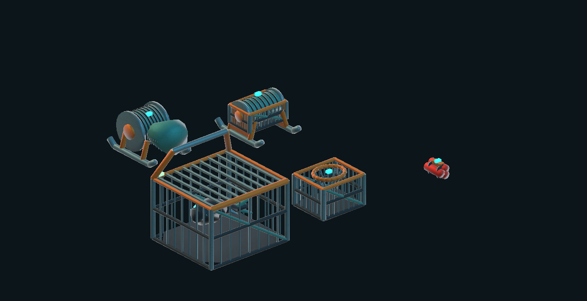

# RAID-020 · Технологии и изобретения

Девятый сектор находится на штатном мониторе прокачки NEREID. Общие чертежи, их модули и состояние установок принадлежат экипажу. Ветка содержит 13 изобретений и 105 покупаемых узла, включая сами чертежи. Источники характеристик — [каталог](../../../Assets/_Game/Progression/Resources/Technology/catalog.json), [стадии и зависимости](../../../Assets/_Game/Progression/Resources/Technology/stages.json), [настройки промысла](../../../Assets/_Game/Systems/Resources/IndustrialFishery/active.json) и [калибровка оборудования](../../../Assets/_Game/Systems/Resources/TechIndustry/calibration.json).

## Первый рейс

1. Подойдите к монитору, откройте «Технологии и изобретения», выберите категорию и чертёж. Справа показаны материалы, текущий эффект, результат покупки и условие открытия. Цвет и надпись различают чертёж, параметр, функцию и автоматику.
2. Купите чертёж из общей казны. Рядом с монитором стоит шкаф «Выдача снаряжения». Наведитесь на дверцу и нажмите **E**. Выберите открытое изобретение и один из четырёх личных слотов. Каждое нажатие выдаёт одну бесплатную копию, удержание Enter заполняет выбранную стопку. В одном слоте хранится один вид. Вкладка **Tab** открывает собственное снаряжение в рейсе. Извлеките единицу из слота, чтобы взять установку в руки. Напарник может взяться за вторую рукоять тяжёлой установки.
3. Выйдите через шлюз, наведитесь на дно и дождитесь разрешающего контура. **T** устанавливает оборудование или присоединяет водолаза к переноске. **Shift+T** отпускает рукоять. **Y** и **U** выполняют контекстные операции, назначение отображается у прицела.
4. **I** у добывающей установки перекладывает доступный улов в переносную корзину. Поднесите её или загруженную клетку к грузовому подъёмнику и нажмите **I**. Затем поднимите груз и выберите штатную переработку либо кормление. У пневмопочты и автоматического транспорта есть прямой путь к резервуару с проверкой свободного места.
5. **O** расходует металлолом на ремонт. У лебёдки **H** закрепляет трос. Кнопка «Камера робота» на мониторе передаёт управление аппаратом. Стрелки и Page Up / Page Down задают движение, Enter работает захватом, Home вызывает возврат, End включает автоматическое задание при соответствующем улучшении, Esc возвращает обычный вид.

## Вместимость личного слота

| Предмет | Базовая стопка | После I, II и III ранга «Вместимость стопки» |
| --- | ---: | --- |
| Динамит | 3 | 5, 8, 12 |
| Рыбная ловушка и пузырьковый генератор | 2 | 3, 4, 6 |
| Остальные десять изобретений | 1 | 2, 3, 4 |

Каждый чертёж улучшает вместимость только своего вида. Все четыре слота принимают одинаковый вид при желании игрока. Готовый к работе экземпляр извлекается по одному, даже если в слоте целая стопка. Пустую исправную установку можно убрать обратно. Установки с живой добычей, грузом, прикреплённым тросом или напарником остаются в мире до завершения операции. Содержимое слотов доступно владельцу после переподключения.

## Как открывается ветка

| Стадия | Условие по исследованному миру и чертежам |
| --- | --- |
| I · Ручной промысел | Первая глубина |
| II · Кооперативный промысел | Один чертёж стадии I или выше |
| III · Механизация | Открытая вторая глубина и два чертежа стадии II или выше |
| IV · Автоматизация | Вторая глубина и один чертёж стадии III или выше |
| V · Промышленный промысел | Вторая глубина и три чертежа стадии III или выше |

У отдельных узлов есть зависимости от другого оборудования. Например, промышленная клетка требует искусственную приманку и транспорт. Для NetEel остаётся нужен живой доброволец даже после полной автоматизации.

## Оборудование

| Изобретение | Ручной цикл | Что меняют улучшения |
| --- | --- | --- |
| Динамит | Игровой расходник бросают в воду. Уцелевшая рыба остаётся подбираемым уловом, водолазы рядом рискуют здоровьем | Запас, радиус улова, сохранность, дистанционная и групповая активация |
| Рыбосос | Один водолаз ведёт сопло, другой поддерживает контейнер. Засор очищается отдельно | Производительность, объём, размер допустимой рыбы, компактный комплект, стационарная работа и передача груза |
| Невод | Два водолаза берут противоположные кромки, растягивают и замыкают контур вокруг живого косяка | Размах, прочность, объём, автоматическое стягивание, стационарное исполнение и разгрузка |
| Рыбная ловушка | Забирает подходящую свободную рыбу в радиусе установки. Полную ловушку разгружают корзиной | Вместимость, частота, число ловушек, защита, маяк для сканера, доставка и групповая отправка с терминала |
| Акустический манок | Звуковой импульс смещает реальную рыбу к прибору и может заинтересовать хищника | Радиус, сила, частота выбора рыбы, снижение нежелательных сигналов и автономная работа |
| Пузырьковый загон | Пара генераторов образует границу, которая меняет направление косяка | Длина, число генераторов, интенсивность, автономная работа и направление рыбы к точке промысла |
| Рыбная ферма | Две небольшие рыбы одного вида с этой глубины остаются производителями. Игрок ухаживает за садком и забирает молодь | Ёмкость, темп, дополнительные садки, поддержание среды, автоматические сбор и доставка |
| Клетка для монстров | Доброволец фиксируется в открытой клетке. Напарник наблюдает за подходом реального хищника и спускает створку. Аварийный выход доступен изнутри и снаружи | Прочность, удержание, размер, скорость закрытия, датчик, искусственная приманка, переноска и автономная доставка |
| Переносная лебёдка | Водолаз закрепляет трос, напарник работает приводом. Трос тянет другой прибор, груз или самого водолаза | Длина, масса, скорость, дистанционный привод, автоматическая буксировка и обслуживание клеток |
| Магнит | Подтягивает физический утиль на дне. Масса и препятствия ограничивают захват | Радиус, сила, предельная загрузка, фильтр, стационарный сбор и выгрузка |
| Кислородная станция | Оператор распределяет конечный запас воздуха, у корабля заправляет баллоны | Ёмкость, расход, несколько шлангов, автоматическая раздача и медленная регенерация у поверхности |
| Подводный робот | Оператор судовой камеры подводит аппарат к утилю, улову, другому прибору или товарищу | Радиосвязь, скорость, грузоподъёмность, спасательный захват, возврат, сбор и обслуживание сети |
| Пневмопочта | Водолаз загружает станцию и отправляет капсулу. До подтверждённой выгрузки содержимое остаётся в манифесте | Объём, время рейса, дальность, число станций, автоматический приём ловушек и промышленной сети |

## Состояние мира и сохранение

- Владелец водолаза отправляет команду FishNet. Хост проверяет отправителя, расстояние, состояние рук, глубину, доступ к корабельному монитору и стоимость операции. При покупке клиент передаёт ожидаемые ранг и ревизию казны. Исследования и улучшения оплачиваются из казны. Раздатчик выдаёт любые открытые предметы бесплатно. Хост отдельно проверяет физическую дверцу, приватный слот и число выставленных установок.
- У установки есть серийный номер, глубина, координаты, состояние, ресурсы, здоровье и привязки экипажа. Каждая рыба сохраняет идентификатор при переходах через установку, корзину, транспорт, подъёмник и резервуар. Переработка начисляет материалы в существующей системе. Пневмопочта ждёт освобождения места с тем же грузом.
- Схема 6 принимает сохранения схем 4 и 5. Для прежних игроков создаются четыре пустых слота снаряжения. Старые личные навыки и командные идентификаторы сохраняются. Сохраняются чертежи, серийные номера, содержимое, производители фермы, накопленный прогресс и полёт капсулы. При загрузке система освобождает привязки к прежним сетевым соединениям. Запись использует существующий атомарный формат проекта с контрольной суммой.
- На исследованной неактивной глубине ловушка использует образец обычной рыбы, полученный в этой точке. Садок продолжает цикл при соблюдении ограничений по уходу, вместимости и производителям. За время закрытой игры доход не начисляется.
- Корпуса, движущиеся узлы и маяки используют общие меши и материалы. Сервер моделирует улов и взаимодействия, клиент воспроизводит корпуса, привод, освещение, тросы, шланги, звук и частицы. Для клетки предусмотрены открытая створка, сигнал взведения, живой пленник и повреждённый перекошенный затвор.

[Экономика, исходные значения и модель окупаемости](ECONOMY.md) · [Журнал делегирования и приёмки](REVIEW.md) · [Результаты проверок](QA.md)

